# 133. Clone Graph

  
**LeetCode:** https://leetcode.com/problems/clone-graph/

## Problem
You're given a reference to a node in a connected, undirected graph. Each node has a value and a list of neighbor references. Produce a deep copy of the entire graph (new node objects, same structure and values) and return the reference to the cloned starting node.

**Input:** a `Node` (with `.val` and `.neighbors`) — the graph may contain cycles
**Output:** a `Node` reference to the cloned graph's equivalent starting node

**Examples:**
1. Graph `1 -- 2 -- 3 -- 1` (a triangle, adjacency `{1:[2,3], 2:[1,3], 3:[1,2]}`) → a fresh triangle of new node objects with the same values and connections.
2. A single node with no neighbors, `{1:[]}` → a single cloned node, `neighbors = []`.
3. `node = None` (empty graph) → return `None`.

**Constraints:** number of nodes in `[0, 100]`, node values are unique, graph is connected and undirected (may have cycles, so naive recursion without tracking visited nodes will loop forever).

> **🔑 Pattern Recognition**
> A graph traversal that must survive cycles → always pair the traversal with a visited/clone map so each node is processed exactly once; store the mapping *before* recursing into neighbors so a cyclic back-edge short-circuits instead of looping forever.

## Intuition
The graph can have cycles, so we can't just recursively clone every neighbor blindly — we need a map from "original node" → "its clone" so we never build the same clone twice and never recurse forever.

### 1. Brute Force
- Two-pass approach: first BFS the original graph to discover every node and create an empty clone for each (map original → clone, no edges wired yet). Second pass, walk the original nodes again and wire up each clone's `neighbors` list using the map.
- Correct because by the time we wire edges, every node's clone already exists in the map, so cycles are trivially handled — we just look them up instead of recursing.
- Time complexity: O(V + E)  Space complexity: O(V) for the map/queue
- Two full passes over the node set is unnecessary overhead — we can clone and wire in one traversal.

### 2. Better
- Single-pass BFS: start from the given node, put its clone in the map immediately. Process a queue of *original* nodes; for each, iterate its neighbors — if a neighbor hasn't been cloned yet, clone it and enqueue it; either way, append the neighbor's clone to the current clone's neighbor list.
- Correct for the same reason (map lookup handles cycles), but now cloning and wiring happen together, saving the second pass.
- Time complexity: O(V + E)  Space complexity: O(V) for map + queue
- Iterative style works fine, but recursion (DFS) reads more naturally for "clone this node's whole subgraph" and avoids managing an explicit queue.

### 3. Optimal
- DFS with memoization: `clone(node)` — if `node` is already in the map, return its clone immediately (this is what breaks cycles). Otherwise create the clone, store it in the map *before* recursing into neighbors (critical — this is what prevents infinite recursion), then recursively clone each neighbor and append to the new node's neighbor list.
- Storing the clone in the map before recursing is the key trick: when a cyclic neighbor points back to a node currently being cloned, the recursive call finds it already in the map and returns instantly instead of looping.
- Time complexity: O(V + E)  Space complexity: O(V) for the map, plus O(V) recursion stack in the worst case (a path-shaped graph)
- Edge cases: `node = None` → return `None` immediately; a single isolated node with no neighbors; a node that's its own neighbor (self-loop, handled fine by the map check).

#### 🎯 Visual Walkthrough
Tracing DFS-with-memoization on Example 1's triangle graph (`1 -- 2 -- 3 -- 1`):

```mermaid
graph TD
    A["visit 1<br/>create clone(1), map&#91;1&#93;=clone1"] --> B["visit 2<br/>create clone(2), map&#91;2&#93;=clone2"]
    B --> C["visit 3<br/>create clone(3), map&#91;3&#93;=clone3"]
    C -->|"neighbor 1 already cloned"| D["return map&#91;1&#93; — breaks the cycle"]
    C -->|"neighbor 2 already cloned"| E["return map&#91;2&#93;"]
    A -->|"neighbor 3 already cloned"| F["return map&#91;3&#93;"]
```

The map lookup on an already-cloned node is what stops the recursion from looping around the triangle forever.

## Complexity Summary
| Approach | Time | Space |
|---|---|---|
| Brute Force | O(V+E) | O(V) |
| Better | O(V+E) | O(V) |
| Optimal | O(V+E) | O(V) |
