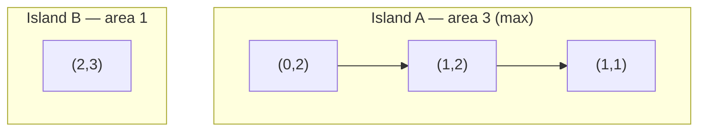

# 695. Max Area of Island

  
**LeetCode:** https://leetcode.com/problems/max-area-of-island/

## Problem
Given a grid of `0`s (water) and `1`s (land), where land cells connect horizontally/vertically into islands, find the area (cell count) of the largest island. Return `0` if there's no land at all.

**Input:** a grid (list of lists) of integers `0`/`1`
**Output:** an integer, the size of the biggest connected group of `1`s

**Examples:**
1.
```
0 0 1 0
0 1 1 0
0 0 0 1
```
→ `3` (the middle blob of three connected 1s is the biggest island; the lone 1 in the corner has area 1).
2. `grid = [[0,0],[0,0]]` → `0` (no land).
3. `grid = [[1,1],[1,1]]` → `4` (the whole grid is one island).

**Constraints:** `1 <= rows, cols <= 50`, grid values are only `0` or `1`.

> **🔑 Pattern Recognition**
> Same connectivity signal as Number of Islands, but the question wants a component's *size*, not just a count — augment the BFS/DFS or Union-Find with a running size per component instead of a plain visited flag.

## Intuition
Same connected-components idea as Number of Islands, except instead of just *counting* islands, we need to track each island's *size* and keep the max.

### 1. Brute Force
- For every unvisited land cell, recursively DFS into its 4 neighbors, counting how many cells belong to that island (using a separate visited matrix). Update a running max after each DFS call returns.
- Correct because each DFS call fully explores exactly one connected component and returns its size.
- Time complexity: O(rows × cols)  Space complexity: O(rows × cols) (visited matrix + recursion stack)
- Recursion depth can be an issue for one giant island filling the whole grid — same concern as Number of Islands.

### 2. Better
- Iterative BFS with an explicit queue, mutating the grid in place (flip visited land to `0`) instead of keeping a separate visited matrix — avoids recursion limits and saves memory.
- Time complexity: O(rows × cols)  Space complexity: O(min(rows, cols)) average queue size, O(rows × cols) worst case
- Still a "flood fill and count per component" approach — doesn't generalize to dynamic/incremental land additions.

### 3. Optimal
- Union-Find (DSU) with path compression and union by rank, where each set also tracks its **size**. Sweep the grid once, activate each land cell (size 1) then union it with its *already-processed* left/up land neighbors, propagating size on every successful union. The answer is the max size seen across all roots.
- This works because DSU maintains component sizes incrementally as unions happen — no separate flood-fill pass needed, and it directly generalizes to "islands that grow over time" style follow-ups.
- Time complexity: O(rows × cols × α(rows × cols)) ≈ O(rows × cols)  Space complexity: O(rows × cols) for parent/rank/size arrays
- Edge cases: all-water grid → max area `0`; single land cell → area `1`; entire grid is land → area `rows*cols`.

#### 🎯 Visual Walkthrough
Tracing size-tracking Union-Find on Example 1's grid:


Each successful union bumps that root's size by one; the max size across all roots (`3`) is the answer.

## Complexity Summary
| Approach | Time | Space |
|---|---|---|
| Brute Force | O(rows·cols) | O(rows·cols) |
| Better | O(rows·cols) | O(min(rows,cols)) avg |
| Optimal | O(rows·cols·α) | O(rows·cols) |
