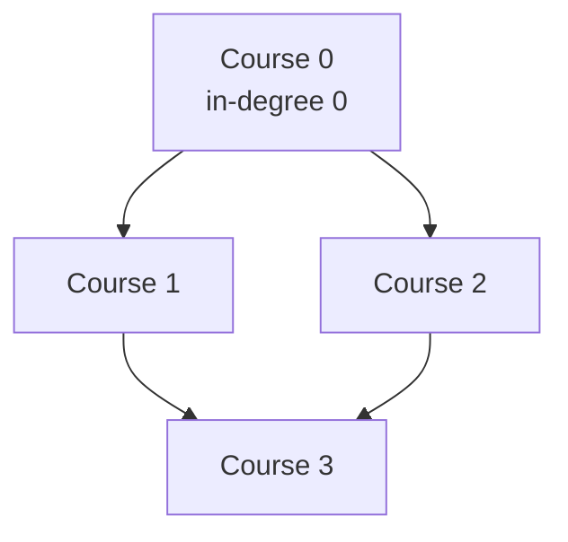

# 207. Course Schedule

  
**LeetCode:** https://leetcode.com/problems/course-schedule/

## Problem
There are `numCourses` courses labeled `0` to `numCourses - 1`. You're given a list of prerequisite pairs `[a, b]` meaning "to take course `a`, you must first take course `b`". Determine whether it's possible to finish all courses (i.e., whether the prerequisites contain no cyclic dependency).

**Input:** an integer `numCourses`, a list of pairs `prerequisites`
**Output:** a boolean — `True` if all courses can be finished, `False` otherwise

**Examples:**
1. `numCourses = 2`, `prerequisites = [[1,0]]` → `True`. Take course `0` first, then `1`.
2. `numCourses = 2`, `prerequisites = [[1,0],[0,1]]` → `False`. Course `1` needs `0`, and `0` needs `1` — a cycle, impossible.
3. `numCourses = 4`, `prerequisites = [[1,0],[2,0],[3,1],[3,2]]` → `True`. This is a DAG: e.g. `0, 1, 2, 3` (or `0, 2, 1, 3`) is a valid order.

**Constraints:** `1 <= numCourses <= 2000`, `0 <= prerequisites.length <= 5000`, no duplicate pairs.

> **🔑 Pattern Recognition**
> "Task A needs task B done first" → directed graph with edges `b -> a`; whether all tasks are finishable is exactly "does this graph have a cycle", answered by topological sort (Kahn's BFS or DFS 3-coloring).

## Intuition
Model courses as nodes and each prerequisite `[a, b]` as a directed edge `b -> a` ("finish b before a"). Finishing all courses is possible exactly when this directed graph has **no cycle** — a cyclic dependency chain can never be satisfied.

### 1. Brute Force
- For every course, run a full DFS from it following prerequisite edges and see if we ever come back to the *same* starting course — if any course can reach itself, there's a cycle. Do this independently for each of the `numCourses` starting points, without sharing any global "already fully explored, definitely cycle-free" information between runs.
- Correct, but re-explores large chunks of the graph again and again from different starting points.
- Time complexity: O(V × (V + E))  Space complexity: O(V + E) for the adjacency list, O(V) recursion stack
- Redundant work — once we know a subgraph is cycle-free from one starting point, we shouldn't have to re-verify it from every other point.

### 2. Better
- Single-pass DFS with 3-state coloring: `unvisited`, `visiting` (currently on the recursion stack), `visited` (fully explored, confirmed safe). DFS from every unvisited node once; if we ever hit a node that's currently `visiting` (i.e., an ancestor in the current DFS path), we've found a back-edge — a cycle. Nodes are only marked `visited` after all their neighbors are safely explored, and we never re-enter an already-`visited` node.
- Correct because a cycle in a directed graph is detected precisely by finding a back-edge to a node still on the current recursion stack — the coloring scheme tracks exactly that.
- Time complexity: O(V + E)  Space complexity: O(V + E) for the graph, O(V) recursion stack
- Works well, but recursion depth is a real risk for a long prerequisite chain (2000 courses deep), and interviewers often want to see the iterative Kahn's algorithm version too since it directly produces a topological order (useful for the follow-up, LC 210).

### 3. Optimal
- Kahn's algorithm (BFS-based topological sort): compute each course's in-degree (number of prerequisites). Start a queue with all courses that have in-degree `0` (no prerequisites). Repeatedly pop a course, "complete" it, and decrement the in-degree of every course that depends on it — if a dependent's in-degree hits `0`, enqueue it. If we manage to process all `numCourses` courses this way, there's no cycle; if some courses never reach in-degree `0`, they're stuck in a cycle.
- This works because a node can only ever be safely "completed" once every one of its prerequisites has been completed — which is exactly what in-degree tracking with a queue guarantees, level by level, with no recursion needed.
- Time complexity: O(V + E)  Space complexity: O(V + E) for the graph + in-degree array + queue
- Edge cases: `numCourses = 1` with no prerequisites (trivially `True`); a self-loop `[0, 0]` (immediately a cycle, in-degree of `0` never reaches `0`... careful: this is `True` in-degree stays 1 forever); duplicate/parallel prerequisite pairs generally aren't present per constraints, but the algorithm handles them fine either way.

#### 🎯 Visual Walkthrough
Tracing Kahn's algorithm on Example 3's dependency DAG (`numCourses=4`, `prerequisites=[[1,0],[2,0],[3,1],[3,2]]`):

Start the queue with in-degree-`0` course `0`; processing it drops `1` and `2` to in-degree `0`; processing both drops `3` to in-degree `0`. All 4 courses get processed → no cycle → `True`.

## Complexity Summary
| Approach | Time | Space |
|---|---|---|
| Brute Force | O(V·(V+E)) | O(V+E) |
| Better | O(V+E) | O(V+E) |
| Optimal | O(V+E) | O(V+E) |
