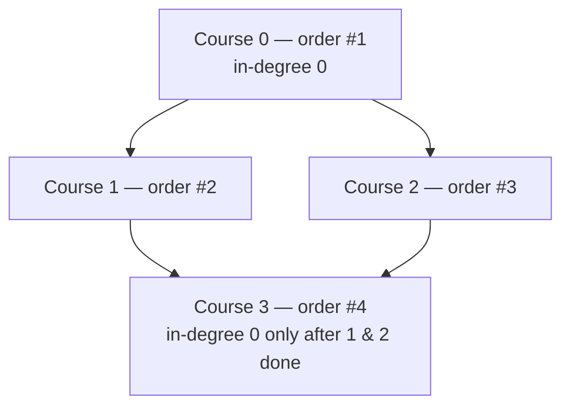

# 210. Course Schedule II

  
**LeetCode:** https://leetcode.com/problems/course-schedule-ii/

## Problem
Same setup as Course Schedule (LC 207): `numCourses` courses and a list of prerequisite pairs `[a, b]` meaning "take `b` before `a`". This time, instead of a yes/no answer, return **one valid order** in which to take all courses. If it's impossible (a cyclic dependency exists), return an empty array.

**Input:** an integer `numCourses`, a list of pairs `prerequisites`
**Output:** a list of course indices in a valid completion order (any valid order is accepted), or `[]` if impossible

**Examples:**
1. `numCourses = 2`, `prerequisites = [[1,0]]` → `[0, 1]` (must take `0` before `1`).
2. `numCourses = 4`, `prerequisites = [[1,0],[2,0],[3,1],[3,2]]` → e.g. `[0, 1, 2, 3]` or `[0, 2, 1, 3]` — both valid since `1` and `2` don't depend on each other.
3. `numCourses = 2`, `prerequisites = [[1,0],[0,1]]` → `[]` (cycle, impossible).

**Constraints:** `1 <= numCourses <= 2000`, `0 <= prerequisites.length <= 5000`, no duplicate pairs.

> **🔑 Pattern Recognition**
> Same DAG-feasibility signal as Course Schedule, but now the interview wants the actual order produced — Kahn's BFS builds it directly forward as courses hit in-degree `0`; DFS postorder works too but needs a final reversal.

## Intuition
This is literally "produce a topological sort of the prerequisite DAG, or detect that it isn't a DAG." Same core idea as LC 207, but now we must actually construct and return the order instead of just a boolean.

### 1. Brute Force
- Repeatedly scan the *entire* remaining course list to find any course whose prerequisites are all already taken; add it to the order and remove it from consideration; repeat until either all courses are placed or a full scan finds nothing new to add (which means a cycle involving whatever remains).
- Correct — this is a manual, unindexed version of Kahn's algorithm — but recomputing "are all prerequisites satisfied" by rescanning from scratch every round is wasteful.
- Time complexity: O(V^2 + V×E) (V rounds, each round scans up to all remaining courses and their prerequisite lists)  Space complexity: O(V + E)
- The naive rescanning is exactly the inefficiency Kahn's algorithm with in-degrees is designed to eliminate.

### 2. Better
- DFS-based topological sort: for every unvisited course, DFS through its prerequisites (using 3-color marking to detect cycles, same as LC 207), and push each course onto a stack **after** all of its dependencies have been fully explored (postorder). If a cycle is detected at any point, return `[]` immediately. Otherwise, the reverse of the postorder stack is a valid topological order.
- Correct because postorder DFS finishes a node only after all nodes it depends on are finished, so reversing that sequence puts dependencies before dependents.
- Time complexity: O(V + E)  Space complexity: O(V + E) graph + O(V) recursion stack
- Recursion depth risk on long chains (up to 2000 courses); also conceptually a bit less intuitive than Kahn's for producing an *ordering* directly (postorder + reversal is an extra mental step).

### 3. Optimal
- Kahn's algorithm (BFS topological sort): compute in-degree for every course, seed a queue with all in-degree-`0` courses, and repeatedly pop a course, append it directly to the answer (no reversal needed — order is built forwards), and decrement in-degrees of its dependents, enqueueing any that hit `0`. If the final answer contains all `numCourses` courses, return it; otherwise a cycle blocked some courses, so return `[]`.
- This works for the same underlying reason as LC 207 — in-degree-`0` exactly characterizes "safe to take now" — and it builds the order directly and iteratively, with no recursion and no need to reverse anything.
- Time complexity: O(V + E)  Space complexity: O(V + E) graph + in-degree array + queue
- Edge cases: `numCourses = 1`, no prerequisites → `[0]`; a self-loop prerequisite `[0,0]` → `[]` (in-degree never reaches 0); disconnected groups of courses with no edges between them → both groups still get fully ordered.

#### 🎯 Visual Walkthrough
Tracing Kahn's algorithm on Example 2's DAG (`numCourses=4`, `prerequisites=[[1,0],[2,0],[3,1],[3,2]]`), one valid resulting order:

Appending each course the instant its in-degree hits `0` builds the answer directly: `[0, 1, 2, 3]` (or `[0, 2, 1, 3]`, both valid).

## Complexity Summary
| Approach | Time | Space |
|---|---|---|
| Brute Force | O(V^2 + V·E) | O(V+E) |
| Better | O(V+E) | O(V+E) |
| Optimal | O(V+E) | O(V+E) |
