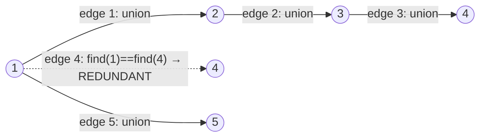

# 684. Redundant Connection

  
**LeetCode:** https://leetcode.com/problems/redundant-connection/

## Problem
You start with a tree of `n` nodes (labeled `1` to `n`) and `n` edges instead of the usual `n-1` — meaning exactly one extra edge was added, creating exactly one cycle. Given the edges in the order they were added, find the **last** edge in the list that, if removed, turns the graph back into a tree. If several edges could be removed to break the cycle, return the one that appears last in the input.

**Input:** a list of edges `[u, v]`, each an undirected edge between two node labels
**Output:** a single edge `[u, v]` — the redundant one

**Examples:**
1. `edges = [[1,2],[1,3],[2,3]]` → `[2,3]`. Nodes `1,2,3` form a tree with edges `[1,2]` and `[1,3]`; adding `[2,3]` closes a cycle, and it's the last edge added, so it's the answer.
2. `edges = [[1,2],[2,3],[3,4],[1,4],[1,5]]` → `[1,4]`. Edges `1-2-3-4` plus `1-4` closes a cycle; `[1,4]` is the last edge that completes it (edge `[1,5]` comes after but doesn't participate in any cycle).
3. `edges = [[1,2],[1,3],[1,4],[1,5]]` → this is already a valid tree (`n=5` nodes, `4` edges, no redundant edge) — not a real test case for this problem since the problem guarantees exactly one redundant edge exists, but illustrates why we must find the *specific* edge that closes a loop.

**Constraints:** `n` nodes, `n` edges, `1 <= u, v <= n`, `u != v`, no duplicate edges, exactly one redundant edge exists in the input.

> **🔑 Pattern Recognition**
> "`n` nodes, `n` edges, exactly one cycle" → process edges one at a time with Union-Find; the first edge whose endpoints already share a root is precisely the one that closes the cycle.

## Intuition
Adding an edge between two nodes that are **already connected** through existing edges is exactly what creates a cycle. So we process edges one at a time, and the first time an edge connects two nodes that are already in the same connected component, that edge is the culprit.

### 1. Brute Force
- Process edges one at a time. For each edge `[u, v]`, temporarily remove it from the whole edge list and check (via BFS/DFS) whether `u` and `v` are still connected through the *remaining* edges. The first edge (scanning from the end, or checking every edge and taking the last one that works) whose removal still leaves the graph fully connected as a tree is the answer. A simpler brute equivalent: for each edge in order, check via BFS/DFS over *all previously added edges* whether `u` and `v` are already connected — if yes, that's a candidate answer; keep scanning to find the last such edge.
- Correct, but rerunning a full BFS/DFS traversal for every single edge is expensive.
- Time complexity: O(n^2) (n edges, each triggering an O(n) traversal over the edges added so far)  Space complexity: O(n) for the adjacency list built incrementally
- Doesn't scale gracefully and re-derives connectivity from scratch every time, when incremental tracking would be much cheaper.

### 2. Better
- Union-Find *without* path compression and *without* union by rank/size (a "naive" DSU where `find` just walks parent pointers and `union` always attaches one root under the other arbitrarily). Process edges in order; for edge `[u, v]`, if `find(u) == find(v)` they're already connected — that's the redundant edge, return it. Otherwise `union(u, v)`.
- Still correct — Union-Find's core connectivity guarantee doesn't require compression/rank to work, just to work *fast* — but without those optimizations, the parent-pointer chains can degenerate into long paths (worst case a straight line), making each `find` call slow.
- Time complexity: O(n^2) worst case (each `find` can take O(n) if the tree of parent pointers becomes a chain)  Space complexity: O(n)
- Gets the right answer but the "union always attach arbitrarily" strategy can build a badly unbalanced structure — exactly the inefficiency the standard optimizations fix.

### 3. Optimal
- Union-Find *with* path compression and union by rank. Same process-edges-in-order logic, but every `find` call flattens the path it walks, and every `union` attaches the smaller/shallower tree under the larger/deeper one — keeping the structure nearly flat.
- This works for the same connectivity reason as above, but path compression + union by rank together give near-constant amortized time per operation (the famous inverse-Ackermann bound), so the whole algorithm processes all `n` edges in almost linear time.
- Time complexity: O(n × α(n)) ≈ O(n)  Space complexity: O(n) for parent/rank arrays
- Edge cases: the redundant edge appears very early (still detected correctly, we just keep scanning — no, we return the *first* edge whose union fails, which by the problem's guarantee of exactly one cycle is also the *last* one that would need removing, since exactly one edge closes the single cycle); a self-referential edge isn't possible per constraints (`u != v`).

#### 🎯 Visual Walkthrough
Tracing Union-Find on Example 2's edges (`[[1,2],[2,3],[3,4],[1,4],[1,5]]`):

Edges 1-3 build the chain `1-2-3-4`. Edge 4 (`[1,4]`) tries to union two nodes already in the same set — that's the redundant edge, returned immediately.

## Complexity Summary
| Approach | Time | Space |
|---|---|---|
| Brute Force | O(n^2) | O(n) |
| Better | O(n^2) worst case | O(n) |
| Optimal | O(n·α(n)) | O(n) |
