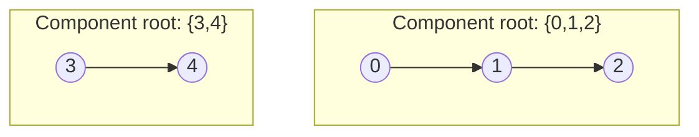

# 323. Number of Connected Components in an Undirected Graph

  
**LeetCode:** https://leetcode.com/problems/number-of-connected-components-in-an-undirected-graph/

> **Note:** This is a LeetCode **Premium/locked** problem, but it's an extremely common interview question (Meta and Amazon both ask it frequently) since it's the cleanest possible setup for practicing Union-Find fundamentals.

## Problem
You have `n` nodes labeled `0` to `n-1` and a list of undirected edges connecting pairs of them. Count how many separate connected components exist in the graph.

**Input:** an integer `n`, a list of edges `[u, v]`
**Output:** an integer, the number of connected components

**Examples:**
1. `n = 5`, `edges = [[0,1],[1,2],[3,4]]` → `2`. Component `{0,1,2}` and component `{3,4}`.
2. `n = 5`, `edges = [[0,1],[1,2],[2,3],[3,4]]` → `1`. All 5 nodes chain together into one component.
3. `n = 4`, `edges = []` → `4`. No edges at all means every node is its own isolated component.

**Constraints:** `1 <= n <= 2000`, `0 <= edges.length <= n*(n-1)/2`, no duplicate/self-loop edges.

> **🔑 Pattern Recognition**
> "How many separate groups" with edges arriving as a list → start from `n` singleton components and decrement a running counter on every *successful* Union-Find merge; no traversal needed at all.

## Intuition
This is the textbook definition of "connected components" — group nodes together if they're reachable from each other, and count the groups. Any traversal-based or Union-Find-based method works; the interesting part is comparing their trade-offs.

### 1. Brute Force
- Build a full **adjacency matrix** (`n x n` grid of booleans) from the edge list. Then, for each unvisited node, DFS/BFS through the matrix (checking every possible neighbor `0..n-1` for a connection, not just an adjacency list) to mark its whole component, incrementing the component count once per unvisited node found.
- Correct, but scanning an entire row of the matrix (`O(n)`) to find neighbors for every node visited is wasteful when the graph is sparse (few edges relative to `n^2` possible ones).
- Time complexity: O(n^2 + E) to build the matrix and traverse it  Space complexity: O(n^2) for the matrix
- The `O(n^2)` matrix is expensive in both time and memory for large sparse graphs — most real-world graphs (and most interview graphs) are sparse.

### 2. Better
- Build a standard **adjacency list** instead of a matrix, then run DFS or BFS from every unvisited node, counting how many separate traversals are needed to cover all `n` nodes.
- Correct for the same reachability reason, and now each edge is only examined a constant number of times overall rather than paying for `n^2` matrix cells.
- Time complexity: O(V + E)  Space complexity: O(V + E) for the adjacency list + visited array
- Solid and often exactly what's expected — but Union-Find is the more idiomatic tool here since components form incrementally as edges are added, with no need for explicit traversal.

### 3. Optimal
- Union-Find (DSU) with path compression and union by rank. Start with `n` separate components (`n` singleton sets). For each edge `[u, v]`, union the two nodes' sets; every *successful* union (merging two previously-different components) decreases the component count by one. The final count is the answer.
- This works because Union-Find directly maintains "how many distinct groups are there" as a running counter, updated in near-constant time per edge — no traversal needed at all, and it naturally extends to online/incremental versions of the problem (edges arriving one at a time, need the count after each).
- Time complexity: O((V + E) × α(V)) ≈ O(V + E)  Space complexity: O(V) for parent/rank arrays
- Edge cases: `n = 1` with no edges → `1` component; no edges at all → `n` components (every node isolated); all nodes connected into one chain → `1` component.

#### 🎯 Visual Walkthrough
Tracing Union-Find on Example 1 (`n=5`, `edges=[[0,1],[1,2],[3,4]]`):

3 edges, 3 successful unions, count starts at `5` and drops by `1` each merge → `5 - 3 = 2` components.

## Complexity Summary
| Approach | Time | Space |
|---|---|---|
| Brute Force | O(n^2 + E) | O(n^2) |
| Better | O(V+E) | O(V+E) |
| Optimal | O((V+E)·α(V)) | O(V) |
