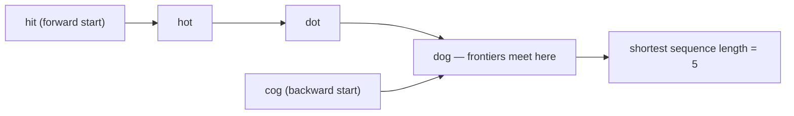

# 127. Word Ladder

  
**LeetCode:** https://leetcode.com/problems/word-ladder/

## Problem
You're given a `beginWord`, an `endWord`, and a dictionary `wordList`. Find the length of the **shortest transformation sequence** from `beginWord` to `endWord`, where each step changes exactly one letter, and every intermediate word (including `endWord`) must exist in `wordList`. Return `0` if no such sequence exists.

**Input:** strings `beginWord`, `endWord`, and a list of strings `wordList`
**Output:** an integer, the number of words in the shortest transformation sequence (counting both `beginWord` and `endWord`), or `0` if impossible

**Examples:**
1. `beginWord = "hit"`, `endWord = "cog"`, `wordList = ["hot","dot","dog","lot","log","cog"]` → `5`. One shortest path: `hit -> hot -> dot -> dog -> cog` (5 words total, 4 one-letter changes).
2. `beginWord = "hit"`, `endWord = "cog"`, `wordList = ["hot","dot","dog","lot","log"]` → `0`. `cog` is not in the word list, so it can never be reached.
3. `beginWord = "a"`, `endWord = "c"`, `wordList = ["a","b","c"]` → `2`. `a -> c` directly (single-letter words differ by exactly one letter trivially since they're both one character).

**Constraints:** `1 <= beginWord.length <= 10`, all words the same length, `1 <= wordList.length <= 5000`, all lowercase English letters, `beginWord != endWord`.

> **🔑 Pattern Recognition**
> "Shortest transformation sequence, one change at a time" → treat each string as a node with an edge between words differing by one letter; shortest sequence = BFS shortest path on that implicit graph, and bidirectional BFS (meeting in the middle) is the optimal refinement.

## Intuition
Think of every word as a node, with an edge between two words if they differ by exactly one letter. We want the shortest path from `beginWord` to `endWord` in this unweighted graph — and shortest path in an unweighted graph is exactly what **BFS** is built for.

### 1. Brute Force
- Standard BFS, but to find neighbors of the current word, scan the **entire word list** and check each candidate word for a one-letter difference (compare character by character). This "is this a neighbor" check costs `O(wordLength)`, done against every word in the list, for every word we pop off the BFS queue.
- Correct — BFS still explores level by level, giving the true shortest path — but neighbor-finding itself is slow.
- Time complexity: O(wordListLen^2 × wordLength)  Space complexity: O(wordListLen) for the queue/visited set
- With up to 5000 words, `wordListLen^2` gets into the tens of millions of character comparisons — too slow for the tightest constraints.

### 2. Better
- Same BFS, but generate neighbors *intelligently*: for the current word, try replacing each of its `L` positions with each of the 26 letters, and check if the resulting string is in a **hash set** of the word list (O(1) lookup instead of scanning). This turns "find all neighbors" from `O(wordListLen × L)` into `O(26 × L)`.
- Time complexity: O(wordListLen × 26 × L)  Space complexity: O(wordListLen × L) for the word set + queue
- Already the standard efficient BFS — asymptotically about as good as single-direction BFS gets. The remaining lever is reducing the *search space actually explored*, not the per-word cost.

### 3. Optimal
- **Bidirectional BFS**: run two simultaneous BFS frontiers, one expanding forward from `beginWord` and one expanding backward from `endWord`. At each step, always expand the *smaller* frontier first. The search ends the moment the two frontiers touch (a word appears in both).
- This works because BFS's search space grows exponentially with depth (branching factor ~26×L per level) — meeting in the middle means each side only needs to search to roughly *half* the depth, which is an exponential reduction in total nodes visited, even though the asymptotic worst-case complexity notation looks similar.
- Time complexity: O(26 × L × wordListLen) worst case, but with a much smaller practical constant since both frontiers together explore far fewer states than one-directional BFS to the same depth  Space complexity: O(wordListLen × L)
- Edge cases: `endWord` not in `wordList` → return `0` immediately without searching; `beginWord` already differs from `endWord` by one letter → answer `2`; `beginWord` itself happens to be in `wordList` (fine, doesn't affect correctness since we never need to "reach" it).

#### 🎯 Visual Walkthrough
Tracing bidirectional BFS on Example 1 (`beginWord="hit"`, `endWord="cog"`, `wordList=["hot","dot","dog","lot","log","cog"]`):

The forward frontier from `hit` and backward frontier from `cog` meet at `dog`, confirming the shortest chain `hit -> hot -> dot -> dog -> cog` (`5` words).

## Complexity Summary
| Approach | Time | Space |
|---|---|---|
| Brute Force | O(wordListLen^2 · L) | O(wordListLen) |
| Better | O(wordListLen · 26 · L) | O(wordListLen · L) |
| Optimal | O(26 · L · wordListLen), smaller constant | O(wordListLen · L) |
