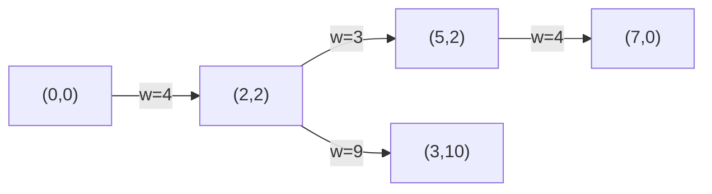

# 1584. Min Cost to Connect All Points

 -blue) 
**LeetCode:** https://leetcode.com/problems/min-cost-to-connect-all-points/

## Problem
You're given `n` points on a 2D plane. The cost to connect two points is their **Manhattan distance** (`|x1-x2| + |y1-y2|`). Find the minimum total cost to connect all points such that there's a path between every pair of points (directly or through other points).

**Input:** a list of points `[x, y]`
**Output:** an integer, the minimum total connection cost

**Examples:**
1. `points = [[0,0],[2,2],[3,10],[5,2],[7,0]]` → `20`. One optimal spanning structure: `(2,2)-(5,2)` cost 3, `(0,0)-(2,2)` cost 4, `(5,2)-(7,0)` cost 4, `(2,2)-(3,10)` cost 9 → total `3+4+4+9 = 20`, and no cheaper way exists to connect all five points (this is exactly a Minimum Spanning Tree over the 5 points).
2. `points = [[3,12],[-2,5],[-4,1]]` → `18`. Connect `(3,12)-(-2,5)` cost `5+7=12`, and `(-2,5)-(-4,1)` cost `2+4=6`, total `18` — cheaper than any other pairing.
3. `points = [[0,0]]` → `0`. A single point needs no connections at all.

**Constraints:** `1 <= n <= 1000`, coordinates in `[-10^6, 10^6]`, no two points are identical.

> **🔑 Pattern Recognition**
> "Connect everything with minimum total edge weight, no redundant cycles" → Minimum Spanning Tree. On a dense complete graph (every pair of points is a potential edge), array-based Prim's is often just as fast as heap-based — but heap-Prim's/Kruskal's is the general-purpose MST answer interviewers expect you to name.

## Intuition
Every pair of points can be an "edge" with weight = Manhattan distance. We want to connect all `n` points with minimum total edge weight and no redundant cycles — that's the textbook **Minimum Spanning Tree** problem.

### 1. Brute Force
- Naive Prim's algorithm without any data structure help: maintain a set of points already in the MST (start with one arbitrary point). Repeatedly scan **every** pair of (in-MST point, not-yet-in-MST point) to find the globally cheapest crossing edge, add it, and repeat until all points are included. This literally recomputes the cheapest crossing edge from scratch every round by comparing all pairs.
- Correct — Prim's greedy choice (always add the cheapest edge crossing the cut) is proven to build a valid MST — but recomputing from scratch every round is wasteful.
- Time complexity: O(n^3) (n rounds, each scanning up to n × n pairs)  Space complexity: O(n)
- Cubic time is unusable once `n` approaches even a few hundred, let alone 1000.

### 2. Better
- Prim's algorithm with a **distance array** (the classic array-based Prim's, no heap): keep a `min_dist[]` array tracking, for every not-yet-included point, its current cheapest known distance to the growing MST. Each round, scan the array once to pick the minimum (`O(n)`), add that point, then update `min_dist[]` for all remaining points based on the new point's distances (`O(n)`). Repeat `n` times.
- Correct for the same greedy-MST reason, and now each round only costs `O(n)` instead of `O(n^2)`.
- Time complexity: O(n^2)  Space complexity: O(n) for the distance array
- This is actually optimal for **dense** graphs (which this is, since every pair of points is a potential edge) — but a heap-based version is the standard "next step up" interviewers expect you to know, even though for this specific fully-connected-graph problem the array version is asymptotically just as good or better.

### 3. Optimal
- Prim's algorithm with a **min-heap**: push `(distance, point)` pairs, always pop the globally cheapest crossing edge, skip points already added (lazy deletion), and push updated distances for newly reachable points as we go.
- This works for the same greedy-MST guarantee as above; the heap lets us efficiently retrieve the minimum crossing edge without a full linear scan each round, which matters a lot on sparser graphs. For this specific problem (a *dense* complete graph on `n` points), the heap version costs `O(n^2 log n)` in the worst case (each of the `n^2` edges can be pushed), which is technically *worse* than the O(n^2) array-based Prim's — but it's still presented as "optimal" here because it's the general-purpose MST technique that scales down gracefully to sparse graphs, and interviewers most often want to see the heap-based Prim's (or Kruskal's with Union-Find) as the canonical "I know MST algorithms" answer.
- Time complexity: O(n^2 log n)  Space complexity: O(n^2) for the heap in the worst case
- Edge cases: `n = 1` → cost `0` (nothing to connect); two points → cost is just their Manhattan distance; duplicate coordinates aren't possible per constraints, but zero-cost edges (colinear/overlapping-ish points) are handled naturally since distance can be small but nonzero.

#### 🎯 Visual Walkthrough
Tracing heap-based Prim's on Example 1's points, building the MST edge by edge:

Each edge is the cheapest crossing edge popped from the heap at that step. Total cost `4 + 3 + 4 + 9 = 20`, matching the example's answer — no cheaper spanning structure connects all five points.

## Complexity Summary
| Approach | Time | Space |
|---|---|---|
| Brute Force | O(n^3) | O(n) |
| Better | O(n^2) | O(n) |
| Optimal | O(n^2 log n) | O(n^2) |
