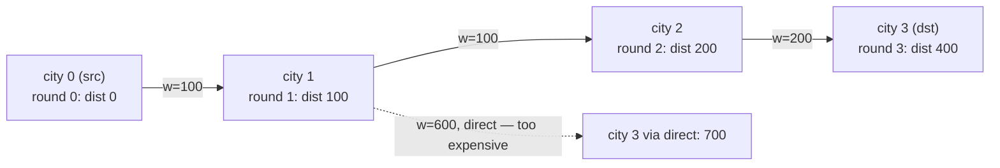

# 787. Cheapest Flights Within K Stops

  
**LeetCode:** https://leetcode.com/problems/cheapest-flights-within-k-stops/

## Problem
There are `n` cities connected by directed flights `flights[i] = [from, to, price]`. Find the cheapest price to fly from `src` to `dst` using **at most `k` stops** (i.e., at most `k+1` flights/edges). Return `-1` if no such route exists.

**Input:** integer `n`, list of edges `[from, to, price]`, integers `src`, `dst`, `k`
**Output:** an integer, the cheapest total price within the stop limit (or `-1`)

**Examples:**
1. `n = 4`, `flights = [[0,1,100],[1,2,100],[2,0,100],[1,3,600],[2,3,200]]`, `src = 0`, `dst = 3`, `k = 1` → `700`. With at most 1 stop (2 flights), the route `0 -> 1 -> 3` costs `100 + 600 = 700` (the cheaper 3-flight route `0->1->2->3` needs 2 stops, which exceeds the limit).
2. Same graph, `k = 2` → `400`. With up to 2 stops allowed, the route `0 -> 1 -> 2 -> 3` costs `100+100+200 = 400`, cheaper than the 1-stop route from Example 1 (that route was invalid in Example 1 because it needs 2 stops, exceeding `k=1`).
3. `n = 3`, `flights = [[0,1,100],[1,2,100],[0,2,500]]`, `src = 0`, `dst = 2`, `k = 0` → `500`. With 0 stops allowed (direct flight only), we must take `0 -> 2` directly, costing `500` (the cheaper 2-hop route needs 1 stop, not allowed here).

**Constraints:** `1 <= n <= 100`, `0 <= flights.length <= n*(n-1)`, `0 <= price <= 10^4`, `0 <= src, dst, k < n`, `src != dst`, no duplicate edges.

> **🔑 Pattern Recognition**
> Shortest path with a hard cap on the number of edges used → plain Dijkstra can't naturally respect a hop limit since it finalizes nodes by distance alone. Run Bellman-Ford for exactly `k+1` rounds (round `i` finds the best path using at most `i` edges), reading from a snapshot each round so hops don't silently chain within one pass.

## Intuition
This is shortest path with an extra twist: a hard cap on the number of edges used. Plain Dijkstra doesn't have a natural way to enforce "at most `k` stops" since it greedily finalizes nodes by distance alone, ignoring how many hops it took — so we need something that's explicitly aware of *both* cost and stop count.

### 1. Brute Force
- DFS/backtracking: explore every possible path from `src`, stopping any branch once it uses more than `k+1` edges, and track the minimum cost among all paths that reach `dst` within the limit.
- Correct — it's an exhaustive search — but the number of paths can blow up combinatorially since we might revisit routing options many different ways.
- Time complexity: O(V^k) worst case (branching factor up to V at each of up to k+1 steps)  Space complexity: O(k) recursion depth
- Exponential blowup makes this impractical once `k` or the graph's branching factor grows.

### 2. Better
- Modified Dijkstra where the priority queue state is `(cost, node, stops_used)` instead of just `(cost, node)` — critically, we do **not** mark a node as permanently "done" the way standard Dijkstra does, because a path that's more expensive so far might still be valid if it uses fewer stops (and a cheaper-but-over-the-limit path should lose to it). We only prune a state if we've already reached that `(node, stops_used)` combination more cheaply before.
- This works because tracking stops as part of the state prevents the algorithm from wrongly cutting off a higher-stop-count-but-lower-cost path that's actually within budget, or from missing a path that needs the extra flexibility a plain "visited" set would block.
- Time complexity: O(E × k × log(V × k)) roughly, since each (node, stop-count) pair can be pushed/relaxed multiple times  Space complexity: O(V × k) for tracking best-cost-per-stop-count
- Correct and reasonably efficient, but more subtle to implement correctly than a clean Bellman-Ford pass, and the "don't mark visited normally" caveat is an easy source of bugs.

### 3. Optimal
- **Bellman-Ford limited to exactly `k+1` relaxation rounds**: initialize `dist[src] = 0`, everything else infinity. For each of `k+1` rounds, relax every edge — but using a **copy** of the previous round's distances as the read source, so we don't accidentally let a single round "chain" multiple hops together (which would violate the stop limit).
- This works because Bellman-Ford's `i`-th round of relaxation, by construction, finds the shortest path using **at most `i` edges** — so stopping after exactly `k+1` rounds directly encodes "at most `k+1` edges" (`k` stops), with no separate stop-tracking needed at all.
- Time complexity: O(k × E)  Space complexity: O(V) for the distance array (two copies)
- Edge cases: `k = 0` (direct flights only — a single relaxation round); `src == dst` isn't possible per constraints but would trivially be `0`; no route exists within the stop limit → `-1`; a cheaper route exists but requires more than `k` stops (must correctly be excluded, unlike plain Dijkstra which would find it and ignore the stop cap).

#### 🎯 Visual Walkthrough
Tracing bounded Bellman-Ford on Example 2 (`k=2`, so `3` relaxation rounds): the cheap 3-hop route wins over the pricier direct-ish option.

Route `0 -> 1 -> 2 -> 3` finishes in round `3` (within the `k+1=3` round budget) at cost `400` — cheaper than the 1-stop route from Example 1 (`700`), which needed fewer rounds but a pricier edge.

## Complexity Summary
| Approach | Time | Space |
|---|---|---|
| Brute Force | O(V^k) | O(k) |
| Better | O(E·k·log(V·k)) | O(V·k) |
| Optimal | O(k·E) | O(V) |
