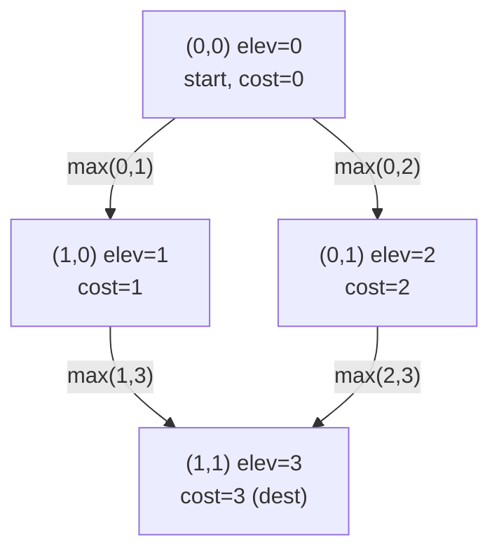

# 778. Swim in Rising Water

 -blue) 
**LeetCode:** https://leetcode.com/problems/swim-in-rising-water/

## Problem
You're on an `n x n` grid where cell `(i, j)` has elevation `grid[i][j]`. Water rises over time: at time `t`, every cell with elevation `<= t` is submerged (swimmable). You start at `(0, 0)` and want to reach `(n-1, n-1)`, moving to adjacent cells (up/down/left/right) only if that cell is currently submerged. Find the minimum time `t` at which such a path exists.

**Input:** a grid (list of lists) of distinct integers `0` to `n^2-1`
**Output:** an integer, the minimum time to have a swimmable path from top-left to bottom-right

**Examples:**
1. `grid = [[0,2],[1,3]]` → `3`. At `t=3` every cell is submerged; you need `t>=3` because you must eventually step on the cell with elevation `3` to reach the bottom-right corner (or route around it, but here there's no way to avoid the max along any path since it's a 2x2 grid).
2. `grid = [[0,1,2,3,4],[24,23,22,21,5],[12,13,14,15,16],[11,17,18,19,20],[10,9,8,7,6]]` → `16`. This is the classic spiral example — the optimal path threads through cells with elevation at most `16`.
3. `grid = [[0]]` → `0`. Single cell, already both start and destination, no water needed.

**Constraints:** `n == grid.length == grid[i].length`, `1 <= n <= 50`, all elevations are a permutation of `0..n^2-1` (distinct).

> **🔑 Pattern Recognition**
> "Minimize the maximum value along a path" → this is a minimax-path problem, solved with a Dijkstra variant where relaxation uses `max()` instead of `+`; the same greedy property (the cheapest-by-running-max unvisited cell is already final) still holds.

## Intuition
We need the smallest `t` such that a path exists using only cells with elevation `<= t`. Equivalently: among all paths from start to end, find the one that **minimizes the maximum elevation cell along the path** — this is a "minimax path" problem.

### 1. Brute Force
- Try every possible value of `t` from `0` up to `n^2 - 1`, one at a time, and for each `t` run a full BFS/DFS from `(0,0)` using only cells with elevation `<= t`, checking whether `(n-1, n-1)` is reachable. Stop at the first (smallest) `t` that works.
- Correct — it's a direct simulation of "what's the smallest threshold that connects start to end" — but re-running a full grid traversal for every candidate `t` is wasteful, especially since most values of `t` don't change reachability at all.
- Time complexity: O(n^2 × n^2) = O(n^4) (up to `n^2` candidate times, each triggering an `O(n^2)` traversal)  Space complexity: O(n^2)
- Extremely wasteful — we're linearly scanning through `t` when we could binary search instead.

### 2. Better
- Binary search on the answer `t`: since "can we reach the end using only cells `<= t`" becomes `True` at some threshold and stays `True` for all larger `t` (monotonic), binary search over `t` and use BFS/DFS as the reachability check for each candidate.
- Correct because of that monotonicity — once a path becomes possible at some threshold, raising the threshold further only unlocks more cells, never fewer.
- Time complexity: O(n^2 log(n^2)) (log(n^2) binary search steps, each an O(n^2) BFS/DFS)  Space complexity: O(n^2)
- Good, but still runs a fresh traversal at every binary search step; a single well-designed pass can find the answer directly without repeated searches.

### 3. Optimal
- Treat this as a **minimax path** problem solved with a Dijkstra-flavored approach: push `(elevation, row, col)` into a min-heap starting from `(grid[0][0], 0, 0)`. Repeatedly pop the cell with the smallest "path cost so far" (where cost = the max elevation seen along the path to reach it, not a sum), mark visited, and for each unvisited neighbor push `(max(current_path_cost, neighbor_elevation), nr, nc)`. The first time we pop `(n-1, n-1)`, its recorded cost is the answer.
- This works because it's exactly Dijkstra's algorithm with the "distance" relaxation redefined as `max` instead of `+` — the greedy property still holds (the cheapest-by-max-so-far unvisited cell's cost is already final, since any other route to it can only have an equal or larger running max), so we never need to reconsider a cell once popped.
- Time complexity: O(n^2 log n)  Space complexity: O(n^2) for visited + heap
- Edge cases: `n = 1` → answer is `grid[0][0]` (or by problem convention, `0`, since you start there); the start or end cell itself might have a large elevation, which sets a hard floor on the answer regardless of the rest of the grid.

#### 🎯 Visual Walkthrough
Tracing the minimax-Dijkstra on Example 1 (`grid=[[0,2],[1,3]]`):

Both routes into `(1,1)` are forced through elevation `3` — the running max never drops below it — so the minimum time to reach the destination is `3`.

## Complexity Summary
| Approach | Time | Space |
|---|---|---|
| Brute Force | O(n^4) | O(n^2) |
| Better | O(n^2 log(n^2)) | O(n^2) |
| Optimal | O(n^2 log n) | O(n^2) |
