# 55. Jump Game

**LeetCode:** https://leetcode.com/problems/jump-game/

## Problem
You start at index 0 of an array where `nums[i]` is the maximum number of steps you may jump forward from index `i`. Determine whether you can reach the last index.

Input: `nums`, a list of non-negative integers.
Output: a boolean.

**Example 1:** `nums = [2,3,1,1,4]` → `true`. Jump 1 step from index 0 to 1, then 3 steps from index 1 to index 4 (the last index).

**Example 2:** `nums = [3,2,1,0,4]` → `false`. Every path funnels into index 3, whose value is 0, stranding you there with the last index unreachable.

**Example 3:** `nums = [0]` → `true`. Already standing on the last (and only) index — no jump needed.

Constraints: `1 <= nums.length <= 10^4`, `0 <= nums[i] <= 10^5`.

> **🔑 Pattern Recognition:** "Can I reach the end given a per-position max reach?" → track a single running frontier (`farthest`) instead of every reachable index. Local optimal choice (always trust the largest reach seen so far) leads to the global answer — classic greedy.

## Intuition (explained simply)
Instead of asking "which exact path of jumps gets me to the end?", ask a simpler running question while scanning left to right: "what is the farthest index I could possibly reach *so far*, given everything I've seen up to this point?" If that farthest-reachable marker ever falls behind the index we're currently examining, we're stuck — no jump from anywhere already-visited can get us this far, so the end is unreachable. Otherwise, keep extending the marker as far as each position allows, and if it ever reaches (or passes) the last index, success.

### 1. Brute Force
- Recurse/backtrack from each index: from index `i`, try every jump length `1` to `nums[i]`, and recursively check if any of them can eventually reach the last index. Return true if any branch succeeds.
- Correct because it exhaustively explores every possible sequence of jumps.
- Time complexity: O(2^n) worst case (branching factor up to `nums[i]` at each of `n` positions). Space complexity: O(n) recursion depth.
- Exponential blowup — no chance on `n` up to 10,000.

### 2. Better
- Turn it into a DP: `dp[i] = True` if index `i` is reachable from index 0. `dp[0] = True`. For each reachable index `i` (scanning left to right), mark `dp[j] = True` for every `j` in `(i, i+nums[i]]`. The answer is `dp[n-1]`.
- Correct because it's the same reachability question, just computed iteratively with memoized reachability instead of re-deriving it via recursion each time.
- Time complexity: O(n^2) worst case — for each of `n` indices, marking up to `nums[i]` further cells. Space complexity: O(n) for the `dp` array.
- Quadratic is wasteful — we don't actually need to know reachability of *every* index individually, only whether the *frontier* of reachability ever gets stuck before the end.

### 3. Optimal
- Track a single value, `farthest`, initialized to 0 — the furthest index reachable using jumps from any position visited so far. Scan `i` from 0 to `n-1`: if `i > farthest`, index `i` itself is unreachable, so stop and return false immediately. Otherwise update `farthest = max(farthest, i + nums[i])`. If at any point `farthest >= n - 1`, return true.
- **Why the greedy "just track the farthest reach" choice is safe:** reachability is monotonic — if some index `i` is reachable, so is every index behind it that was already covered, and the only thing that matters for reaching further is the single best (largest) jump opportunity seen among all indices visited so far. There is never a benefit to remembering *which* specific earlier index gave the best reach or *how* we got there — only the maximum "how far" value matters, because from any point behind the frontier, the best possible next move is already captured in that running maximum.
- Time complexity: O(n) — one linear pass. Space complexity: O(1) — one scalar.
- Edge cases: `n == 1` → already at the last index, return true immediately without needing any jump; a `0` at a non-final index can strand you if it's not already covered by an earlier long jump — the frontier check (`i > farthest`) catches this exactly.

#### 🎯 Visual Walkthrough
Tracing `nums = [2,3,1,1,4]` (Example 1, answer `true`):

```mermaid
flowchart TD
    A["i=0, nums&#91;0&#93;=2<br/>farthest=max(0,0+2)=2"] --> B["i=1, nums&#91;1&#93;=3<br/>farthest=max(2,1+3)=4"]
    B --> C["i=2, nums&#91;2&#93;=1<br/>farthest=max(4,2+1)=4"]
    C --> D["farthest=4 >= last index (4)<br/>reachable, can stop early"]
    D --> E["Answer: true"]
```

## Complexity Summary
| Approach | Time | Space |
|---|---|---|
| Brute Force | O(2^n) | O(n) |
| Better | O(n^2) | O(n) |
| Optimal | O(n) | O(1) |
