# 1899. Merge Triplets to Form Target Triplet

**LeetCode:** https://leetcode.com/problems/merge-triplets-to-form-target-triplet/

## Problem
You have a list of triplets (each an array of 3 integers). A "merge" operation picks two triplets and produces a new one by taking the elementwise maximum of the two (e.g. merging `[2,5,3]` and `[1,7,9]` gives `[2,7,9]`). Determine whether, by merging some subset of your triplets together (in any order, any number of times), you can produce exactly the given `target` triplet.

Input: `triplets`, a list of `[a, b, c]` integer triples; `target`, a single `[x, y, z]` triple.
Output: a boolean.

**Example 1:** `triplets = [[2,5,3],[1,8,4],[1,7,5]], target = [2,7,5]` → `true`. Merge `[2,5,3]` and `[1,7,5]`: elementwise max gives `[2,7,5]`, exactly the target.

**Example 2:** `triplets = [[3,4,5],[4,5,6]], target = [3,2,5]` → `false`. Both triplets have a middle value (4 or 5) exceeding the target's middle value 2 — merging can only grow values, never shrink below what any contributing triplet already has, so `target[1]=2` is unreachable.

**Example 3:** `triplets = [[1,2,3]], target = [1,2,3]` → `true`. The single triplet already equals the target — no merge needed.

Constraints: `1 <= triplets.length <= 10^5`, `triplets[i].length == target.length == 3`, `1 <= triplets[i][j], target[j] <= 1000`.

> **🔑 Pattern Recognition:** An operation that can only move values in one direction (max never overshoots, only grows) → discard anything that could ever overshoot the target, then greedily fold in everything that's still safe. "Never hurts, might help" is the greedy safety argument here.

## Intuition (explained simply)
Merging takes an elementwise max, so merging can only ever *increase or keep* each coordinate — it can never lower a value. That means: (1) **any** triplet with a coordinate that exceeds the corresponding target coordinate is permanently disqualified from participating in any merge (it would poison that coordinate above the target and there's no way to bring it back down), and (2) among the triplets that don't have that problem ("compatible" triplets, where every coordinate is `<= target`), we just need to check whether their combined elementwise max reaches the target exactly in all three positions — because merging every compatible triplet together (elementwise max, which never overshoots since each is `<=` target already) is always at least as good as merging any subset of them.

### 1. Brute Force
- Try all subsets of the triplets, compute the elementwise max of each subset, and check if any subset's combined max equals the target.
- Correct because it's an exhaustive check of every possible combination of triplets to merge.
- Time complexity: O(2^n * 3) — `2^n` subsets, O(1) (3 coordinates) work to combine each incrementally, but naively recomputing from scratch is O(2^n * n). Space complexity: O(n) for a subset / O(1) extra if combined incrementally during recursive enumeration.
- Exponential — utterly infeasible for `n` up to 100,000.

### 2. Better
- First filter out any triplet with a coordinate exceeding the corresponding target coordinate (it can never help and could only be included if we're careful never to let it dominate — simpler to discard it outright since it's never needed: any valid solution set can safely exclude such triplets too, per the reasoning above). Then, instead of a single combined pass, iterate coordinate by coordinate (`x`, `y`, `z`): for each coordinate, check whether *any* surviving triplet achieves exactly `target[coord]` at that position. If all three coordinates have at least one witness among the surviving triplets, return true.
- Correctness follows from the same "no coordinate can exceed target" filtering argument, plus the fact that each coordinate of the target just needs *some* qualifying triplet to hit it exactly (since other coordinates of that same triplet don't matter for this check — we can pick different triplets to satisfy different coordinates, then imagine merging all qualifying triplets together, since merging never overshoots for filtered triplets).
- Time complexity: O(n) — one filtering pass plus a constant amount of work (3 coordinate checks) per triplet. Space complexity: O(1) extra (aside from input).
- This is essentially the same linear-time idea as Optimal, computed via three explicit "does any survivor hit target[coord] exactly" flags rather than a single running elementwise-max accumulator — Optimal folds this into one pass with one accumulator instead of conceptually separate coordinate scans.

### 3. Optimal
- Single pass: maintain a running triplet `best = [0, 0, 0]` (or `-infinity` sentinels). For each triplet in the input, **skip it entirely** if any of its coordinates exceeds the corresponding target coordinate (it's disqualified, as established above). Otherwise, fold it into `best` via elementwise max: `best[k] = max(best[k], triplet[k])` for each of the 3 coordinates. After processing all triplets, check if `best == target`.
- **Why the greedy "just merge every compatible triplet" choice is safe:** every compatible triplet has all coordinates `<= target`, so merging any number of them together via elementwise max can never push any coordinate *past* the target — the running max is always bounded above by the target coordinatewise. Since merging more compatible triplets can only help (nondecreasing max) and never hurt (never overshoots), there's no reason to ever leave a compatible triplet out — including all of them is always at least as good as including any subset.
- Time complexity: O(n) — one linear pass, O(1) work per triplet. Space complexity: O(1) extra — a single running triplet.
- Edge cases: a single triplet equal to target → trivially true; every triplet has some coordinate exceeding target → all filtered out, `best` stays `[0,0,0]` (or below target), answer false; target achievable only by merging *all* triplets together (each contributing a different coordinate) → correctly handled since the accumulator folds in every compatible triplet regardless of which coordinate(s) it uniquely satisfies.

#### 🎯 Visual Walkthrough
Tracing `triplets = [[2,5,3],[1,8,4],[1,7,5]], target = [2,7,5]` (Example 1, answer `true`):

```mermaid
flowchart TD
    A["best=&#91;0,0,0&#93;"] --> B["&#91;2,5,3&#93;: all coords <= target<br/>compatible -> best=max=&#91;2,5,3&#93;"]
    B --> C["&#91;1,8,4&#93;: 8 > target&#91;1&#93;=7<br/>incompatible -> skip, best=&#91;2,5,3&#93;"]
    C --> D["&#91;1,7,5&#93;: all coords <= target<br/>compatible -> best=max=&#91;2,7,5&#93;"]
    D --> E["best == target &#91;2,7,5&#93;<br/>Answer: true"]
```

## Complexity Summary
| Approach | Time | Space |
|---|---|---|
| Brute Force | O(2^n) | O(n) |
| Better | O(n) | O(1) |
| Optimal | O(n) | O(1) |
