# 763. Partition Labels

**LeetCode:** https://leetcode.com/problems/partition-labels/

## Problem
Given a string, split it into as many contiguous partitions ("chunks") as possible so that each letter appears in **at most one** partition (every occurrence of a given letter must land in the same chunk). Return the list of partition lengths, in order.

Input: `s`, a lowercase-letter string.
Output: a list of integers — the size of each partition, left to right.

**Example 1:** `s = "ababcbacadefegdehijhklij"` → `[9,7,8]`. The first 9 characters (`"ababcbaca"`) contain every occurrence of `a`, `b`, `c`; the next 7 (`"defegde"`) contain every occurrence of `d`, `e`, `f`, `g`; the last 8 (`"hijhklij"`) contain every occurrence of `h`, `i`, `j`, `k`, `l`.

**Example 2:** `s = "eccbbbbdec"` → `[10]`. The letters `e` and `c` each reappear all the way at the end, so no split is possible before that — the whole string is one chunk.

**Example 3:** `s = "abc"` → `[1,1,1]`. No letter repeats, so each character is its own partition.

Constraints: `1 <= s.length <= 500`. `s` consists of lowercase English letters only.

> **🔑 Pattern Recognition:** "Cut as soon as it's safe" using each element's last-seen position → greedy two-pointer with a precomputed last-index map. The window's required end only ever grows until the scan catches up — then it's safe to cut.

## Intuition (explained simply)
A partition boundary is only allowed at position `i` if **no letter that has appeared so far reappears later** past position `i`. To know that safely, first find the *last* index where each letter appears anywhere in the string. Then scan left to right, growing the current chunk's "required end" to be the max of the last-occurrence indices of every letter seen so far in this chunk; the moment the scan position catches up to that required end, every letter seen in this chunk is guaranteed to never reappear beyond this point — that's a safe place to cut.

### 1. Brute Force
- For every candidate cut position, check whether it's valid by scanning the rest of the string to see if any character to the left of the cut reappears to the right of it. If valid, commit the cut and recursively partition the remainder; otherwise extend the current chunk by one character and retry.
- Correct because it directly checks the defining property of a valid partition boundary (no character split across chunks) at every possible position.
- Time complexity: O(n^2) — for each of up to `n` candidate cut points, an O(n) validity scan. Space complexity: O(n) for the recursion / output list.
- Quadratic, and re-derives information (character reappearance) that could be precomputed once instead of rechecked from scratch at every candidate boundary.

### 2. Better
- Precompute, for each character, the set of all indices where it appears (or just track "have we seen this character again past a point" using a running count of remaining occurrences). Scan left to right, maintaining a hash map of remaining-occurrence counts (decrement as each character is consumed) and a set of "currently open" characters in the running chunk. A cut is valid when the set of open characters (those whose remaining count has not yet hit zero) is empty.
- Correct because tracking exact remaining counts is a precise (if slightly heavier) way to know when every character seen in the current chunk has been fully exhausted for the rest of the string.
- Time complexity: O(n) — one pass to build counts, one pass to scan with O(1) amortized set operations. Space complexity: O(1) extra (bounded by 26 letters) beyond the output, or O(n) if tracking indices explicitly.
- Functionally equivalent to Optimal in complexity, but tracking full remaining-counts and a live "open characters" set is more bookkeeping than necessary — all that's actually needed is each character's single *last* index, compared against the current position, which is simpler and avoids per-character count decrements.

### 3. Optimal
- Precompute `last_index[c]` = the last position in `s` where character `c` occurs (one pass, O(n)). Then scan left to right with two pointers: `start` (the beginning of the current chunk) and `end` (the running "required end" of the current chunk, initialized to `last_index[s[start]]`). At each position `i`, update `end = max(end, last_index[s[i]])`. When `i == end`, the current chunk is complete — record its length (`end - start + 1`), and set `start = i + 1` for the next chunk.
- **Why the greedy "extend to the max last-index seen, then cut the moment we catch up" choice is safe:** the chunk *must* extend at least to the last occurrence of every character it contains (splitting earlier would break that character across two chunks), and extending any further than necessary only produces fewer, larger partitions — which is never required and never helps make *more* partitions. So the smallest valid extension (stopping exactly when the running position catches up to the required end) is guaranteed to produce the maximum possible number of partitions.
- Time complexity: O(n) — one pass to compute `last_index`, one pass to build partitions. Space complexity: O(1) extra (a fixed-size array/dict of 26 letters) plus O(n) for the output list of partition sizes.
- Edge cases: single character → one partition of length 1; a character that spans the entire string (appears at both index 0 and index n-1) → forces one partition covering the whole string; every character distinct → each is its own length-1 partition.

#### 🎯 Visual Walkthrough
Tracing `s = "ababcbacadefegdehijhklij"` (Example 1, answer `[9,7,8]`):

```mermaid
flowchart TD
    A["start=0<br/>end=last_index&#91;'a'&#93;=8"] --> B["scan 0..8 (a,b,c only)<br/>b last=5, c last=7 - both < 8<br/>i reaches end=8 -> cut"]
    B --> C["Chunk 1: 'ababcbaca'<br/>length 9"]
    C --> D["start=9<br/>end=last_index&#91;'d'&#93;=14<br/>e(15) extends end to 15"]
    D --> E["scan 9..15 (d,e,f,g)<br/>i reaches end=15 -> cut"]
    E --> F["Chunk 2: 'defegde'<br/>length 7"]
    F --> G["start=16<br/>end=last_index&#91;'h'&#93;=19<br/>i(22),j(23) extend end to 23"]
    G --> H["scan 16..23 (h,i,j,k,l)<br/>i reaches end=23 -> cut"]
    H --> I["Chunk 3: 'hijhklij'<br/>length 8"]
    I --> J["Answer: &#91;9,7,8&#93;"]
```

## Complexity Summary
| Approach | Time | Space |
|---|---|---|
| Brute Force | O(n^2) | O(n) |
| Better | O(n) | O(n) |
| Optimal | O(n) | O(1) extra |
