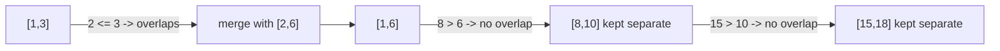

# 56. Merge Intervals

**LeetCode:** https://leetcode.com/problems/merge-intervals/

## Problem
Given a list of intervals (not necessarily sorted, may overlap), merge all overlapping intervals together and return the smallest set of intervals that covers exactly the same ranges.

**Input:** `intervals: List[List[int]]`, each `[start, end]`.
**Output:** a list of merged, non-overlapping intervals sorted by start.

**Example 1:**
`intervals = [[1,3],[2,6],[8,10],[15,18]]` → `[[1,6],[8,10],[15,18]]`
`[1,3]` and `[2,6]` overlap (share 2-3), so they combine into `[1,6]`. The other two don't touch anything.

**Example 2:**
`intervals = [[1,4],[4,5]]` → `[[1,5]]`
They touch exactly at `4`; touching counts as overlapping here, so they merge.

**Example 3:**
`intervals = [[1,4],[0,4]]` → `[[0,4]]`
Unsorted input — after sorting by start, `[0,4]` comes first and fully contains `[1,4]`.

**Constraints:** `1 <= intervals.length <= 10^4`, `0 <= start <= end <= 10^4`.

> **🔑 Pattern Recognition:** Overlapping ranges to combine → sort by start, sweep once, only ever compare against the *last merged* interval. This is the canonical "sort by start, then sweep" interval pattern.

## Intuition (explained simply)
If two intervals overlap, one must start before (or when) the other ends. Sorting by start time turns "any pair might overlap" into "only neighboring intervals can overlap," which we can then check with one linear pass.

### 1. Brute Force
- Repeatedly scan the whole list looking for *any* pair that overlaps, merge that pair into one, put it back, and scan again from the top. Keep going until no pair overlaps.
- Correct because it keeps merging until nothing overlaps left, no matter the order intervals arrive in.
- Time complexity: O(n³) in the worst case (O(n²) pairs found and merged, each restart rescans O(n) items) — some presentations reach O(n²) with more careful bookkeeping, but the naive restart-from-scratch version is worse.
- Space complexity: O(n)
- Why it's not good enough: painfully slow, and re-scanning from scratch after every single merge is wasteful.

### 2. Better
- Sort by start time. Then, for every interval, compare it against *every other* interval placed so far in the result to see if it should merge with any of them (instead of assuming it can only conflict with the very last one added).
- This is correct and faster than full brute force since sorting groups likely-overlapping intervals near each other, but it still doesn't exploit the fact that after sorting, only the *most recently added* merged interval can possibly overlap the next one.
- Time complexity: O(n²) worst case (for each interval, scan the result list)  Space complexity: O(n)
- Still quadratic — doesn't fully use the sorted order.

### 3. Optimal
- Sort by start time. Walk through once, keeping a `merged` result list. For each interval, compare only to the **last** interval added to `merged`: if the current interval's start is `<=` the last one's end, they overlap — extend the last one's end to `max(last.end, current.end)`. Otherwise, the current interval starts a new group — append it as-is.
- Why it works: after sorting by start, if interval `i` doesn't overlap the last *merged* interval, it can't overlap anything merged before that either (their ends are all `<=` the last merged interval's end by construction).
- Time complexity: O(n log n) (sort dominates; the pass itself is O(n))  Space complexity: O(n) (output list; O(log n)-O(n) for the sort itself depending on implementation)
- Edge cases: single interval → returned as-is; all intervals overlapping into one giant interval; intervals given in reverse or random order; touching endpoints must merge (`[1,4],[4,5]` → `[1,5]`).

#### 🎯 Visual Walkthrough
Tracing `intervals = [[1,3],[2,6],[8,10],[15,18]]` (Example 1, answer `[[1,6],[8,10],[15,18]]`), already sorted by start:

Result: `[[1,6],[8,10],[15,18]]`.

## Complexity Summary
| Approach | Time | Space |
|---|---|---|
| Brute Force | O(n³) | O(n) |
| Better | O(n²) | O(n) |
| Optimal | O(n log n) | O(n) |
