# 253. Meeting Rooms II

**LeetCode:** https://leetcode.com/problems/meeting-rooms-ii/

> **Note:** Like LC 252, this problem is LeetCode Premium (locked). It's nonetheless one of the single most frequently asked interval questions at FAANG-style interviews, usually phrased as "how many meeting rooms do you need to book so every meeting has a room?"

## Problem
Given a list of meeting intervals, find the minimum number of rooms required so that all meetings can happen, with no two overlapping meetings sharing a room.

**Input:** `intervals: List[List[int]]`, each `[start, end]`.
**Output:** an integer — the minimum number of rooms needed.

**Example 1:**
`intervals = [[0,30],[5,10],[15,20]]` → `2`
`[0,30]` overlaps both others, but `[5,10]` and `[15,20]` don't overlap each other, so they can share a second room. Peak concurrency is 2 (during `5-10`).

**Example 2:**
`intervals = [[7,10],[2,4]]` → `1`
The meetings don't overlap at all, so one room suffices for both, used one after another.

**Example 3:**
`intervals = [[1,5],[1,5],[1,5]]` → `3`
All three happen at the exact same time, so each needs its own room.

**Constraints:** `1 <= intervals.length <= 10^4`, `0 <= start < end <= 10^6`.

> **🔑 Pattern Recognition:** "How many things overlap at once, at worst?" → sort by start, maintain a min-heap of end times so you always know the *soonest-freeing* room. Peak heap size = peak concurrency = the answer.

## Intuition (explained simply)
The answer is just "the maximum number of meetings happening *at the same time*, at any point in the day." If we can track how many meetings are simultaneously in progress as time moves forward, the peak of that count is our answer.

### 1. Brute Force
- Simulate it directly: keep a list of "room end times." For every meeting, scan the whole list to check if some room already frees up (`room_end <= meeting.start`) — if so, reuse that room (update its end time); otherwise, open a brand new room. The final room count is the answer.
- Correct because it's a direct simulation of what actually happens.
- Time complexity: O(n²) (scan all rooms for every meeting)  Space complexity: O(n)
- Why it's not good enough: quadratic, and it's not obviously extendable to "which room did each meeting get" without more bookkeeping.

### 2. Better
- Split each meeting into two separate events: a "start" timestamp and an "end" timestamp. Sort the starts array and the ends array independently. Walk through both with two pointers: whenever the next chronological event is a start, increment the concurrent-meeting count (and update the max seen so far); whenever it's an end that happens at or before the next start, decrement the count (freeing a room).
- This is correct — it's the "sweep line" technique — and much faster than brute force, but it separates the start/end information from which specific interval it belonged to, which is a little less intuitive to reason about or extend.
- Time complexity: O(n log n)  Space complexity: O(n)
- Fine in practice, but doesn't use a heap even though this is a textbook "min-heap of end times" problem — less natural to extend to "return the room assignment."

### 3. Optimal
- Sort meetings by start time. Use a **min-heap** that stores the end times of currently occupied rooms. For each meeting (in start order): if the heap's smallest end time is `<= current meeting's start`, pop it — a room just freed up, reuse it. Then push the current meeting's end time onto the heap regardless (either reusing a freed slot or a fresh one). The number of rooms needed at any point is the heap's size, so the answer is the **maximum heap size** seen during the process.
- Why it works: the heap always holds exactly the end times of rooms currently in use. Popping the smallest end time whenever it's `<=` the new meeting's start is the greedy optimal choice — if the earliest-freeing room can't be reused, no room can.
- Time complexity: O(n log n) (sort + n heap operations, each O(log n))  Space complexity: O(n) (heap holds up to n end times)
- Edge cases: single meeting → 1 room; all meetings pairwise disjoint → 1 room; all meetings simultaneous → n rooms; touching endpoints (`end == start`) do **not** require separate rooms.

#### 🎯 Visual Walkthrough
Tracing `intervals = [[0,30],[5,10],[15,20]]` (Example 1, answer `2`), sorted by start:

```mermaid
flowchart TD
    A["&#91;0,30&#93;: heap empty<br/>push 30 -> heap=&#91;30&#93;<br/>rooms=1"] --> B["&#91;5,10&#93;: top=30, 30<=5? no<br/>push 10 -> heap=&#91;10,30&#93;<br/>rooms=2"]
    B --> C["&#91;15,20&#93;: top=10, 10<=15? yes<br/>pop 10, push 20 -> heap=&#91;20,30&#93;<br/>rooms stays 2"]
    C --> D["Max heap size seen = 2<br/>Answer: 2 rooms"]
```

## Complexity Summary
| Approach | Time | Space |
|---|---|---|
| Brute Force | O(n²) | O(n) |
| Better | O(n log n) | O(n) |
| Optimal | O(n log n) | O(n) |
