# 66. Plus One

**LeetCode:** https://leetcode.com/problems/plus-one/

## Problem
A non-negative integer is given as an array of its digits, most significant digit first (e.g. `123` is `[1,2,3]`). Add one to the number and return the result in the same digit-array format.

**Input:** `digits: List[int]` (each `0-9`, no leading zeros unless the number itself is `0`).
**Output:** `List[int]` representing `number + 1`.

**Example 1:**
`digits = [1,2,3]` → `[1,2,4]`
`123 + 1 = 124`, no carrying needed.

**Example 2:**
`digits = [4,3,2,1]` → `[4,3,2,2]`
`4321 + 1 = 4322`.

**Example 3:**
`digits = [9,9,9]` → `[1,0,0,0]`
`999 + 1 = 1000` — every digit carries, and the result gains an extra leading digit.

**Constraints:** `1 <= digits.length <= 100`, `0 <= digits[i] <= 9`, no leading zeros (unless the whole array is `[0]`).

> **🔑 Pattern Recognition:** Digit-array carry propagation → walk right to left, and stop the instant a digit doesn't roll over. The invariant that only the trailing run of `9`s can ever carry is the mathematical shortcut here.

## Intuition (explained simply)
This is just elementary-school addition, done from the rightmost (least significant) digit going left, carrying a `1` whenever a digit rolls over from `9` to `0`.

### 1. Brute Force
- Convert the digit array into an actual integer (e.g. by building a string and calling `int(...)`), add `1` using normal integer arithmetic, then convert the result back into a list of digits (via `str(...)`).
- Correct because Python integers have arbitrary precision, so this works for any size input without overflow.
- Time complexity: O(n) (n = number of digits, for the conversions)  Space complexity: O(n)
- Why it's not ideal for an interview: it dodges the actual "manual carrying" logic the interviewer wants to see, and relies on language-specific bigint support that isn't available in every language (e.g. C++/Java need real overflow-safe digit math).

### 2. Better
- Walk the digit array from the end, add `1` to the last digit, and explicitly propagate any carry to the left using a loop — but implemented by building a **new** output list from scratch (instead of mutating in place) and reversing at the end, which does the same job with extra memory shuffling.
- Correct — it manually performs the carry propagation — but allocates more than necessary.
- Time complexity: O(n)  Space complexity: O(n) (new list + reversal)
- A bit wasteful with the extra list/reverse — can be tightened to operate in place.

### 3. Optimal
- Walk the array from the last digit to the first, **in place**. If a digit is less than 9, just increment it and return immediately — no further carrying needed, we're done. If a digit is exactly 9, set it to `0` (it rolled over) and continue the loop leftward to carry the 1. If we fall off the front of the array (every digit was a 9), that means the number was all 9s (like `999`); insert a `1` at the very front.
- Why it works: this is exactly how carrying works in manual addition — a digit only needs to "know" about the carry from its right neighbor, so a single right-to-left pass suffices, and we can early-return the moment a digit doesn't overflow.
- Time complexity: O(n)  Space complexity: O(1) extra (in place; O(n) only in the rare all-9s case where a new array must be returned, unavoidable since the output is one digit longer).
- Edge cases: `[9]` → `[1,0]`; `[0]` → `[1]`; all-9s input of any length; single digit input.

#### 🎯 Visual Walkthrough
Tracing `digits = [9,9,9]` (Example 3, answer `[1,0,0,0]`):

```mermaid
flowchart TD
    A["i=2: digits&#91;2&#93;=9<br/>== 9 -> set to 0, carry left"] --> B["i=1: digits&#91;1&#93;=9<br/>== 9 -> set to 0, carry left"]
    B --> C["i=0: digits&#91;0&#93;=9<br/>== 9 -> set to 0, carry left"]
    C --> D["Fell off the front<br/>all digits were 9<br/>insert 1 at position 0"]
    D --> E["Answer: &#91;1,0,0,0&#93;"]
```

## Complexity Summary
| Approach | Time | Space |
|---|---|---|
| Brute Force | O(n) | O(n) |
| Better | O(n) | O(n) |
| Optimal | O(n) | O(1) extra |
