# 48. Rotate Image

**LeetCode:** https://leetcode.com/problems/rotate-image/

## Problem
You're given an `n x n` 2D matrix representing an image. Rotate the image 90 degrees clockwise, **in place** (you must not allocate a second matrix as your final answer).

**Input:** `matrix: List[List[int]]`, square (`n x n`).
**Output:** none — modify `matrix` in place so it represents the rotated image.

**Example 1:**
`matrix = [[1,2,3],[4,5,6],[7,8,9]]` → becomes `[[7,4,1],[8,5,2],[9,6,3]]`
The first column `[1,4,7]` (bottom to top) becomes the first row.

**Example 2:**
`matrix = [[5,1,9,11],[2,4,8,10],[13,3,6,7],[15,14,12,16]]` → becomes `[[15,13,2,5],[14,3,4,1],[12,6,8,9],[16,7,10,11]]`

**Example 3:**
`matrix = [[1]]` → stays `[[1]]`
A 1x1 matrix rotated is itself.

**Constraints:** `n == matrix.length == matrix[i].length`, `1 <= n <= 20`.

> **🔑 Pattern Recognition:** In-place geometric transform with an O(1)-space constraint → decompose the transform into two simpler, well-known ones (transpose, then reverse rows) whose composition equals the target rotation. Look for a mathematical invariant/decomposition rather than computing the target formula cell-by-cell.

## Intuition (explained simply)
Rotating 90° clockwise moves the element at `(row, col)` to `(col, n-1-row)`. There are a few ways to achieve this: build a brand-new matrix directly from that formula, or find a sequence of simpler, well-known transformations (like transpose + reverse) that combine to the same effect without needing extra space.

### 1. Brute Force
- Allocate a new `n x n` matrix. For every cell `(r, c)` in the original, place its value at `(c, n-1-r)` in the new matrix (that's exactly where a 90°-clockwise rotation sends it). Then copy the new matrix's contents back over the original (to satisfy the "in place" requirement on the given reference, even though we used O(n²) extra memory to get there).
- Correct because it's a direct application of the rotation formula for every cell.
- Time complexity: O(n²)  Space complexity: O(n²) (the extra matrix)
- Why it's not fully satisfying: the problem explicitly asks for O(1) extra space — allocating a whole second grid defeats that constraint even if we copy the values back at the end.
- Time complexity: O(n²)  Space complexity: O(n²)

### 2. Better
- Rotate **layer by layer** (like peeling an onion): for each of the `n/2` outer rings, cycle groups of 4 corresponding cells (top, right, bottom, left) using a temporary variable to hold one value while swapping the other three around. This achieves true O(1) extra space, but the index arithmetic for "the 4 corners of this layer at this offset" is fiddly and easy to get wrong.
- Correct because every element is swapped directly into its final rotated position through the 4-cycle, without ever needing a second matrix.
- Time complexity: O(n²)  Space complexity: O(1)
- Works and is optimal in complexity — but conceptually more error-prone than the composition trick below (this is more of a "different-but-equal" alternative than a worse tier, included here to contrast styles before the cleanest version).

### 3. Optimal
- Use the classic **transpose + reverse each row** trick: first transpose the matrix in place (swap `matrix[i][j]` with `matrix[j][i]` for all `i < j` — this flips it across the main diagonal). Then reverse each row individually. The composition of "transpose" then "reverse rows" is mathematically equivalent to a 90° clockwise rotation.
- Why it works: transposing turns rows into columns; reversing each row afterward is exactly what's needed to flip that transposed layout into the clockwise-rotated one (you can verify with a 3×3 example — transposing `[[1,2,3],[4,5,6],[7,8,9]]` gives `[[1,4,7],[2,5,8],[3,6,9]]`, and reversing each row gives `[[7,4,1],[8,5,2],[9,6,3]]`, which matches).
- Time complexity: O(n²) (must touch every cell)  Space complexity: O(1) extra
- Edge cases: `n = 1` (no-op); already-symmetric matrices; make sure the transpose loop only swaps each off-diagonal pair once (`j` starts at `i+1`, not `0`) to avoid swapping back.

#### 🎯 Visual Walkthrough
Tracing `matrix = [[1,2,3],[4,5,6],[7,8,9]]` (Example 1, answer `[[7,4,1],[8,5,2],[9,6,3]]`):

```mermaid
flowchart TD
    A["Original<br/>&#91;1,2,3&#93;<br/>&#91;4,5,6&#93;<br/>&#91;7,8,9&#93;"] --> B["Transpose (swap across diagonal)<br/>&#91;1,4,7&#93;<br/>&#91;2,5,8&#93;<br/>&#91;3,6,9&#93;"]
    B --> C["Reverse each row<br/>&#91;7,4,1&#93;<br/>&#91;8,5,2&#93;<br/>&#91;9,6,3&#93;"]
    C --> D["Result = 90 degree clockwise rotation"]
```

## Complexity Summary
| Approach | Time | Space |
|---|---|---|
| Brute Force | O(n²) | O(n²) |
| Better | O(n²) | O(1) |
| Optimal | O(n²) | O(1) |
