# 54. Spiral Matrix

**LeetCode:** https://leetcode.com/problems/spiral-matrix/

## Problem
Given an `m x n` matrix, return all its elements visited in spiral order — starting at the top-left, going right across the top row, then down the right column, then left across the bottom row, then up the left column, and spiraling further inward, until every element has been visited.

**Input:** `matrix: List[List[int]]` (not necessarily square).
**Output:** `List[int]` — the elements in spiral visiting order.

**Example 1:**
`matrix = [[1,2,3],[4,5,6],[7,8,9]]` → `[1,2,3,6,9,8,7,4,5]`
Right across the top (`1,2,3`), down the right side (`6,9`), left across the bottom (`8,7`), up the left side (`4`), then the lone center element (`5`).

**Example 2:**
`matrix = [[1,2,3,4],[5,6,7,8],[9,10,11,12]]` → `[1,2,3,4,8,12,11,10,9,5,6,7]`

**Example 3:**
`matrix = [[7]]` → `[7]`
A single cell has nowhere to spiral — just itself.

**Constraints:** `1 <= m, n <= 10`, matrix need not be square.

> **🔑 Pattern Recognition:** Ring-by-ring matrix traversal → track four shrinking boundaries (`top`, `bottom`, `left`, `right`) instead of a `visited` grid. The coordinate-transform trick here is "shrink the frame after each full lap."

## Intuition (explained simply)
A spiral is just "go around the outer border, then shrink the border inward and repeat" until there's nothing left to visit. The tricky part is bookkeeping — knowing exactly which cells belong to the current outer ring and not re-visiting or skipping any.

### 1. Brute Force
- Simulate a walker with a direction (right, down, left, up) and a `visited` grid of booleans the same size as the matrix. At each step, try to move in the current direction; if the next cell is out of bounds or already visited, turn clockwise (right→down→left→up→right) instead. Keep going until every cell has been visited.
- Correct — it's a direct simulation of "keep walking spiral-style, turning when blocked" — and easy to reason about.
- Time complexity: O(m·n) (each of the m·n cells visited once, though checking "already visited" and bounds costs a constant factor of extra work per step)  Space complexity: O(m·n) (the visited grid)
- Why it's not ideal: the extra `visited` grid is unnecessary bookkeeping — the boundary-shrinking approach below tracks the same information with just four integers.

### 2. Better
- Track four boundaries: `top`, `bottom`, `left`, `right`. Repeatedly: walk right across `top` row from `left` to `right`, then down `right` column from `top+1` to `bottom`, then (if there's more than one row left) left across `bottom` row from `right-1` down to `left`, then (if there's more than one column left) up `left` column from `bottom-1` up to `top+1`. After each full loop, shrink all four boundaries inward by 1. Repeat until the boundaries cross.
- Correct — the boundaries always describe exactly the outer ring still left to visit — and no `visited` array is needed. Still, it requires careful "if there's more than one row/column left" guards to avoid re-visiting cells on the final ring (e.g. a matrix with only 1 row or 1 column).
- Time complexity: O(m·n)  Space complexity: O(1) extra (excluding the output list)
- Functionally the standard interview-optimal solution; listed here as "better" mainly because the guard conditions are easy to get subtly wrong compared to the direction-vector version below.

### 3. Optimal
- Same boundary-shrinking idea, but implemented with an explicit list of 4 direction vectors (right, down, left, up) that we cycle through, turning whenever the next step would go out of the current boundary. Track current position and current direction index; after placing each value, try to step in the current direction — if that would exit the shrinking boundary, rotate to the next direction and shrink that boundary, then step. This unifies all four "sides" into one consistent loop body instead of four separate loops, which is less error-prone to write correctly under interview pressure while keeping the same complexity.
- Why it works: the same boundary-shrinking logic as "Better," just restructured so there's one movement rule (not four copy-pasted ones), reducing the chance of an off-by-one bug in one of the four sides.
- Time complexity: O(m·n)  Space complexity: O(1) extra
- Edge cases: single row (`[[1,2,3]]`); single column; single cell; non-square rectangles (more rows than columns or vice versa).

#### 🎯 Visual Walkthrough
Tracing `matrix = [[1,2,3],[4,5,6],[7,8,9]]` (Example 1, answer `[1,2,3,6,9,8,7,4,5]`), boundaries start `top=0,bottom=2,left=0,right=2`:

```mermaid
flowchart TD
    A["Right across top row (row 0)<br/>visit 1,2,3<br/>top=1"] --> B["Down right column (col 2)<br/>visit 6,9<br/>right=1"]
    B --> C["Left across bottom row (row 2)<br/>visit 8,7<br/>bottom=1"]
    C --> D["Up left column: top==bottom now<br/>only one row left, skip<br/>left=1"]
    D --> E["Boundaries closed to single cell (1,1)<br/>visit 5"]
    E --> F["Answer: &#91;1,2,3,6,9,8,7,4,5&#93;"]
```

## Complexity Summary
| Approach | Time | Space |
|---|---|---|
| Brute Force | O(m·n) | O(m·n) |
| Better | O(m·n) | O(1) |
| Optimal | O(m·n) | O(1) |
