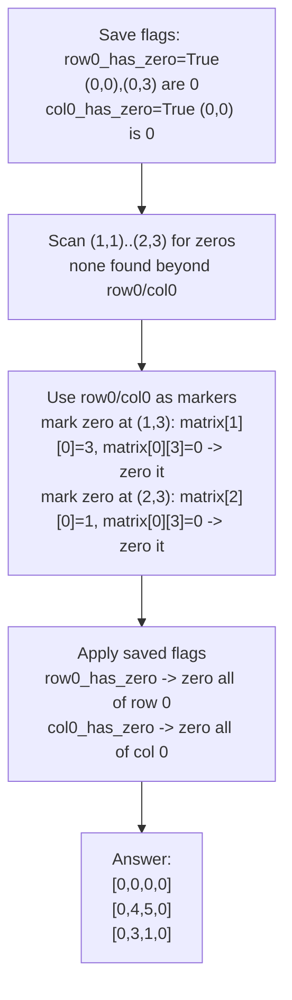

# 73. Set Matrix Zeroes

**LeetCode:** https://leetcode.com/problems/set-matrix-zeroes/

## Problem
Given an `m x n` matrix, if any cell contains `0`, set its **entire row and entire column** to `0`. Do this in place.

**Input:** `matrix: List[List[int]]`.
**Output:** none — modify `matrix` in place.

**Example 1:**
`matrix = [[1,1,1],[1,0,1],[1,1,1]]` → `[[1,0,1],[0,0,0],[1,0,1]]`
The single `0` at `(1,1)` zeroes out row 1 and column 1 entirely.

**Example 2:**
`matrix = [[0,1,2,0],[3,4,5,2],[1,3,1,5]]` → `[[0,0,0,0],[0,4,5,0],[0,3,1,0]]`
Two zeros at `(0,0)` and `(0,3)` zero out row 0 completely, and columns 0 and 3 entirely.

**Example 3:**
`matrix = [[1,2],[3,4]]` → stays `[[1,2],[3,4]]`
No zeros present, nothing changes.

**Constraints:** `1 <= m, n <= 200`, values fit in a 32-bit int.

> **🔑 Pattern Recognition:** Need O(1) extra memory to remember "which rows/columns to zero" → reuse the matrix's own first row/column as marker bits instead of allocating new arrays. Look for a spare place inside the existing structure to stash state.

## Intuition (explained simply)
The danger here is that if you zero out cells as soon as you find a `0`, you'll accidentally create *new* zeros that then trigger zeroing rows/columns that shouldn't have been touched. So we first need to **record** where the original zeros were, and only *then* apply the zeroing — using memory (or clever reuse of the matrix itself) to remember the original zero locations without letting new zeros contaminate that record.

### 1. Brute Force
- Make a full copy of the original matrix. Scan the copy for zeros; for every zero found at `(r, c)`, zero out row `r` and column `c` in the **original** matrix (writing to the original, reading from the untouched copy so we never get confused by zeros we just created).
- Correct because reading from an untouched snapshot means we always act on the *original* zero locations, never on zeros we introduced ourselves.
- Time complexity: O(m·n) to scan + O(m·n) per zero found in the worst case for the row/column writes → O(m²·n + m·n²) worst case if many zeros exist, but a tighter bound treating writes as amortized is O(m·n) scan and up to O(m·n) total writes, so effectively O(m·n) — the real cost that makes this "brute" is the O(m·n) **extra space** for the full copy.
- Space complexity: O(m·n) (the copy)
- Why it's not good enough: uses a full second matrix just to avoid self-interference — an interviewer will push for less memory.

### 2. Better
- Use two separate 1D marker arrays: `zero_rows` (size m) and `zero_cols` (size n), both boolean, initialized to `False`. Scan the whole matrix once; whenever `matrix[r][c] == 0`, mark `zero_rows[r] = True` and `zero_cols[c] = True`. Then scan again, and for every cell whose row or column is marked, set it to `0`.
- Correct — separating "detection" from "mutation" into two passes avoids the self-interference problem, using much less memory than a full copy.
- Time complexity: O(m·n) (two passes)  Space complexity: O(m + n) (the two marker arrays)
- Better than a full copy, but still uses auxiliary memory proportional to the matrix dimensions — the O(1) space version reuses the matrix's own first row/column as the markers.

### 3. Optimal
- Reuse the matrix's own **first row and first column** as the marker arrays instead of allocating new ones. Before doing that, separately remember (in two booleans) whether the first row and first column *themselves* originally contained a zero (since we're about to overwrite them as markers). Then: scan the rest of the matrix (from `(1,1)` onward); whenever `matrix[r][c] == 0`, set `matrix[r][0] = 0` and `matrix[0][c] = 0` as markers. Next, scan the matrix again (excluding row 0 and column 0) and zero out any cell whose row-marker (`matrix[r][0]`) or column-marker (`matrix[0][c]`) is `0`. Finally, use the two booleans saved at the start to zero out the first row and/or first column if they originally had a zero.
- Why it works: the first row and column can each only need to become "all zero" or "not all zero" — exactly one bit of information per row/column — so storing that bit inside the matrix itself (at the intersection of that row/column with row 0 / column 0) needs zero extra memory beyond two flags for the row/column 0 special case.
- Time complexity: O(m·n) (still two passes)  Space complexity: O(1) extra
- Edge cases: zero located in row 0 or column 0 (handled by the two saved booleans); entire matrix is zeros already; single row or single column matrix; no zeros at all (no-op).

#### 🎯 Visual Walkthrough
Tracing `matrix = [[0,1,2,0],[3,4,5,2],[1,3,1,5]]` (Example 2, answer `[[0,0,0,0],[0,4,5,0],[0,3,1,0]]`):

## Complexity Summary
| Approach | Time | Space |
|---|---|---|
| Brute Force | O(m·n) | O(m·n) |
| Better | O(m·n) | O(m+n) |
| Optimal | O(m·n) | O(1) |
