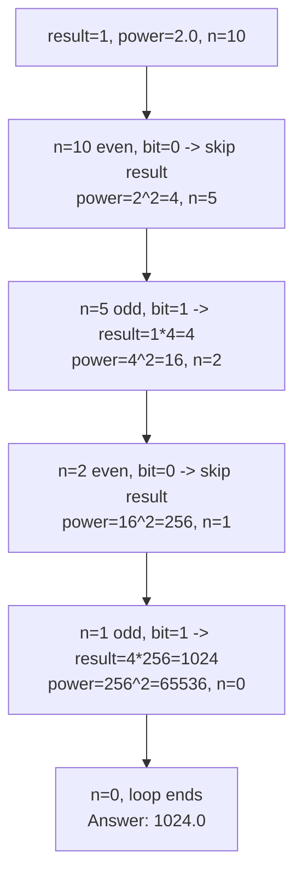

# 50. Pow(x, n)

**LeetCode:** https://leetcode.com/problems/powx-n/

## Problem
Implement a function that computes `x` raised to the power `n` (`x^n`), where `n` is an integer that can be negative, zero, or positive.

**Input:** `x: float`, `n: int`.
**Output:** `float` — `x^n`.

**Example 1:**
`x = 2.0, n = 10` → `1024.0`
`2^10 = 1024`.

**Example 2:**
`x = 2.1, n = 3` → `9.261`
`2.1 * 2.1 * 2.1 = 9.261`.

**Example 3:**
`x = 2.0, n = -2` → `0.25`
Negative exponent means `1 / x^|n|` = `1 / 4 = 0.25`.

**Constraints:** `-100.0 < x < 100.0`, `-2^31 <= n <= 2^31-1`, result fits in a double, `x != 0` if `n < 0`.

> **🔑 Pattern Recognition:** Large exponent to compute fast → binary exponentiation. Decompose `n` into its binary digits and build up `x^1, x^2, x^4, ...` by repeated squaring, multiplying in only the powers whose bit is set — the number-theory invariant is "every integer is a sum of powers of 2."

## Intuition (explained simply)
Multiplying `x` by itself `n` times works but wastes effort — you can compute `x^8` with only 3 multiplications (`x^2, x^4, x^8`) instead of 8, by repeatedly squaring. This "repeated squaring" trick is the classic way to compute large powers fast, and it mirrors how computers do fast modular exponentiation in cryptography too.

### 1. Brute Force
- Multiply `x` by itself `n` times in a simple loop (handle negative `n` by computing the positive-power result and taking its reciprocal at the end).
- Correct — it's the literal definition of exponentiation.
- Time complexity: O(n)  Space complexity: O(1)
- Why it's not good enough: with `n` up to ~2×10⁹, a billion+ multiplications is far too slow for an interview-scale solution — and it doesn't demonstrate the divide-and-conquer insight interviewers are looking for.

### 2. Better
- Recursive halving: `x^n = x^(n/2) * x^(n/2)` (times an extra `x` if `n` is odd). Recurse until `n == 0` (base case: return 1). Handle negative `n` by computing `x^|n|` and inverting the result at the end.
- This cuts the number of multiplications from O(n) down to O(log n) by halving the exponent every call, but it recomputes `x^(n/2)` from scratch in one branch and reuses it via a local variable rather than truly iterating, and the recursion depth adds stack overhead.
- Time complexity: O(log n)  Space complexity: O(log n) (recursion stack)
- Same asymptotic time as optimal, but the recursion stack is extra space that an iterative version avoids.

### 3. Optimal
- **Iterative fast exponentiation** (binary exponentiation): work through the bits of `n` (after taking `abs(n)`) from least significant to most significant. Maintain a running `result` (starts at 1) and a running `current_power` (starts at `x`). At each step, if the current bit of `n` is `1`, multiply it into `result`; then square `current_power` and shift to the next bit (`n //= 2`). At the end, if the original `n` was negative, return `1 / result`.
- Why it works: any integer `n` can be written in binary as a sum of powers of 2 (e.g. `13 = 8+4+1 = 2³+2²+2⁰`), so `x^13 = x^8 * x^4 * x^1`. Repeated squaring builds up `x^1, x^2, x^4, x^8, ...` for free as a side effect of processing each bit, and we multiply in exactly the powers whose bit is set.
- Time complexity: O(log n)  Space complexity: O(1) — no recursion stack needed.
- Edge cases: `n = 0` → always `1` (even for `x = 0`); negative `n` (invert at the end, watch out for `n = -2^31` which has no positive counterpart in a signed 32-bit int — using `abs()` on Python's arbitrary-precision ints handles this fine, but in C++/Java you must cast to a wider type first); `x` negative or fractional.

#### 🎯 Visual Walkthrough
Tracing `x = 2.0, n = 10` (Example 1, answer `1024.0`) — `10` in binary is `1010`:

## Complexity Summary
| Approach | Time | Space |
|---|---|---|
| Brute Force | O(n) | O(1) |
| Better | O(log n) | O(log n) |
| Optimal | O(log n) | O(1) |
