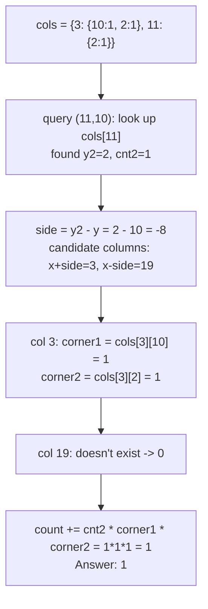

# 2013. Detect Squares


**LeetCode:** https://leetcode.com/problems/detect-squares/

## Problem
Design a data structure that supports adding points on a 2D plane (the same point may be added multiple times) and, given a query point, counting how many **axis-aligned squares** can be formed where the query point is one corner and the other three corners are all points that have been added (each added occurrence usable once per square).

**Methods:**
- `add(point)`: record a point (duplicates allowed and tracked separately).
- `count(point)`: return the number of axis-aligned squares with `point` as one corner and the other three corners among added points.

**Example:**
```
add([3,10]); add([11,2]); add([3,2])
count([11,10]) -> 1   # square (3,10),(11,10),(3,2),(11,2) — all sides axis-aligned, length 8
count([14,8])  -> 0   # no combination of added points completes a square here
add([11,2])            # add a duplicate of an existing point
count([11,10]) -> 2    # the duplicate [11,2] gives a second way to complete the same square shape
```
`[3,10]`, `[11,2]`, `[3,2]` plus query `[11,10]` form a square: same x=3 or x=11 column pairs, same y=2 or y=10 row pairs, and all side lengths equal (8). Adding a duplicate `[11,2]` doubles the count because either copy can serve as that corner.

**Constraints:** up to `3000` calls total to `add` and `count`, `0 <= x, y <= 1000`.

> **🔑 Pattern Recognition:** Axis-aligned square through a query point → the geometric invariant is that two other corners share the query's x or y exactly, and the side length (`|y2 - y|`) fully determines the remaining diagonal corner's coordinates. Group points by column so only geometrically-possible candidates are ever visited.

## Intuition (explained simply)
An axis-aligned square through the query point `(x, y)` always has one other corner directly **above or below** it (same x) and one directly **left or right** (same y), plus a diagonal corner. If we find a point `(x, y2)` in the same column as the query, the side length is `|y2 - y|`, and the square extends either to the right or left by that same distance — so the other two corners are fully determined: `(x ± side, y)` and `(x ± side, y2)`. We just need to check if those two points were added, and multiply by how many times each point (including the column point) was added, since duplicates each represent a distinct way to complete the square.

### 1. Brute Force
- Store every added point in a plain list (duplicates included). For `count(x, y)`: scan the whole list to find distinct `y2` values sharing column `x`. For each candidate `y2`, compute how many times `(x, y2)` was added by scanning the list again (`list.count(...)`), then similarly count occurrences of the two candidate opposite corners by scanning the list yet again for each.
- Correct — it directly checks every possible column point and directly counts occurrences by brute enumeration — but re-scans the entire point list repeatedly.
- Time complexity: O(n) to find column points, times O(n) for each `.count()` lookup → O(n²) per `count()` call.  Space complexity: O(n) (the point list)
- Why it's not good enough: with up to 3000 calls, repeated O(n) scans compound badly.

### 2. Better
- Maintain a single global hash map `point_counts` from `(x, y)` → how many times it was added (O(1) add, O(1) existence/multiplicity lookup). For `count(x, y)`, iterate over **every distinct point ever added** (not just ones in the query's column), skip any that aren't in column `x`, and for the ones that are, do the same corner-computation and O(1) lookups as above.
- This removes the need for repeated linear scans to count occurrences (now O(1) per lookup thanks to the hash map), but it still walks through every distinct added point just to filter down to the ones sharing the query's column, rather than jumping straight to them.
- Time complexity: O(n) per `count()` call (n = number of distinct points added)  Space complexity: O(n)
- Wastes time visiting points that can never contribute (any point not in the query's column is immediately skipped, but we still pay to visit it).

### 3. Optimal
- Maintain a hash map keyed by **x-coordinate**, where each value is itself a hash map (`Counter`) of `y → count` for points in that column: `cols[x][y] = multiplicity`. `add(x, y)` just increments `cols[x][y]`. For `count(x, y)`, look up `cols[x]` directly — this instantly gives only the points that share the query's column, with no wasted visits. For each `(y2, cnt2)` in that column (skip `y2 == y`), compute `side = y2 - y` and check both `x + side` and `x - side` columns for the two needed corners via `cols[x2].get(y, 0)` and `cols[x2].get(y2, 0)`, accumulating `cnt2 * corner1_count * corner2_count`.
- Why it works: grouping points by column upfront means `count()` only ever touches points that could possibly matter (same column as the query) — no wasted work on irrelevant points, and everything else is O(1) hash lookups.
- Time complexity: `add` is O(1); `count` is O(k) where k = number of distinct points sharing the query's column (in the worst case k can be O(n), but in practice — and on average across the constraint of ≤3000 total points — this is much faster than scanning everything).  Space complexity: O(n)
- Edge cases: `count` on a point with nothing in its column → 0; a point added many times (multiplicities multiply across all three non-query corners); query point that happens to also be an added point (doesn't matter — squares are formed from *any* 3 added points plus the query location, whether or not the query itself was ever added).

#### 🎯 Visual Walkthrough
Tracing the worked example: `add([3,10])`, `add([11,2])`, `add([3,2])`, then `count([11,10])` → `1`:



## Complexity Summary
| Approach | Time (count) | Space |
|---|---|---|
| Brute Force | O(n²) | O(n) |
| Better | O(n) | O(n) |
| Optimal | O(k), k = column size | O(n) |
