# 28. Find the Index of the First Occurrence in a String

 -blue) 
**LeetCode:** https://leetcode.com/problems/find-the-index-of-the-first-occurrence-in-a-string/

## Problem
Given a `haystack` string and a `needle` string, find the index of the first occurrence of `needle` inside `haystack`. If `needle` doesn't appear anywhere, return `-1`. (This is essentially reimplementing the classic `strStr()` / `indexOf()` function.)

**Input:** `haystack: str`, `needle: str`.
**Output:** `int` — the starting index of the first match, or `-1`.

**Example 1:**
`haystack = "sadbutsad", needle = "sad"` → `0`
`"sad"` first appears at index 0 (it also appears again at index 6, but we only want the first).

**Example 2:**
`haystack = "leetcode", needle = "leeto"` → `-1`
`"leeto"` never appears as a contiguous substring of `"leetcode"`.

**Example 3:**
`haystack = "hello", needle = ""` → `0`
An empty needle is considered to match at index 0 by convention.

**Constraints:** `0 <= haystack.length, needle.length <= 10^4`.

> 🔑 **Pattern Recognition**
> Finding a needle's first occurrence with worst-case-linear guarantees → build a failure function (LPS array) on the needle first, so a mismatch never forces a full restart. Any "reimplement `strStr`/`indexOf`" ask is the canonical setup for KMP.

## Intuition (explained simply)
The most obvious approach is to try matching the needle starting at every possible position in the haystack. The reason that can be slow is repeated re-checking of characters we've already compared; smarter algorithms use information from a failed match to skip ahead instead of restarting from scratch.

### 1. Brute Force
- For every starting index `i` in `haystack` (where a needle-length substring could still fit), compare `haystack[i:i+len(needle)]` character by character against `needle`. If all characters match, return `i`. If we finish without any match, return `-1`.
- Correct because it exhaustively tries every possible alignment.
- Time complexity: O(n·m) worst case (n = len(haystack), m = len(needle)) — e.g. `haystack = "aaaa...a"`, `needle = "aaa...b"` forces near-full re-comparison at every position.
- Space complexity: O(1)
- Why it's not ideal: no reuse of partial-match information between positions — every restart begins from scratch.

### 2. Better
- **Rabin-Karp rolling hash**: compute a hash of `needle`, then slide a window of the same length across `haystack`, maintaining a rolling hash that can be updated in O(1) per shift (subtract the outgoing character's contribution, multiply, add the incoming character). Whenever the window's hash matches the needle's hash, do a direct character-by-character comparison to confirm (guarding against hash collisions).
- This avoids re-hashing the whole window from scratch at every position, making the *average* case much faster, but a poorly chosen hash (or adversarial input) can still cause many collisions, degrading to the brute-force comparison cost.
- Time complexity: O(n + m) average case, O(n·m) worst case (hash collisions)  Space complexity: O(1)
- Not worst-case guaranteed — still vulnerable to pathological inputs without a well-chosen modulus/base.

### 3. Optimal
- **KMP (Knuth-Morris-Pratt)**: precompute a "failure function" (also called the LPS — longest proper prefix that's also a suffix — array) for the needle. This array tells us, for every prefix of the needle, how long a prefix we can *reuse* as a starting point if a mismatch occurs, without restarting the whole comparison from scratch. Then scan through `haystack` once: whenever characters match, advance both pointers; on a mismatch, use the failure function to jump the needle pointer backward to the longest reusable prefix instead of resetting to 0.
- Why it works: the failure function captures exactly how much "already-matched" information can be salvaged after a mismatch, so we never re-examine a haystack character more than a constant number of times (each haystack pointer only ever moves forward).
- Time complexity: O(n + m) guaranteed — O(m) to build the failure function, O(n) to scan the haystack.  Space complexity: O(m) for the failure function array.
- Edge cases: empty `needle` → return `0`; `needle` longer than `haystack` → return `-1` immediately; needle equal to the entire haystack; repeated characters that stress-test the failure function (e.g. `needle = "aaaab"`).

#### 🎯 Visual Walkthrough
Tracing the KMP scan on Example 1's `haystack = "sadbutsad"`, `needle = "sad"` (LPS array `[0,0,0]` since `"sad"` has no repeated prefix/suffix structure, so every mismatch would fall straight back to index 0):

```mermaid
flowchart TD
    A["i=0: haystack&#91;0&#93;='s', needle&#91;0&#93;='s' -> match"] --> B["i=1: haystack&#91;1&#93;='a', needle&#91;1&#93;='a' -> match"]
    B --> C["i=2: haystack&#91;2&#93;='d', needle&#91;2&#93;='d' -> match, needle fully consumed"]
    C --> D["Report start index = 0"]
```

All three characters match on the very first alignment, so KMP returns `0` immediately — matching Example 1's expected output.

## Complexity Summary
| Approach | Time | Space |
|---|---|---|
| Brute Force | O(n·m) | O(1) |
| Better | O(n+m) avg, O(n·m) worst | O(1) |
| Optimal | O(n+m) | O(m) |
