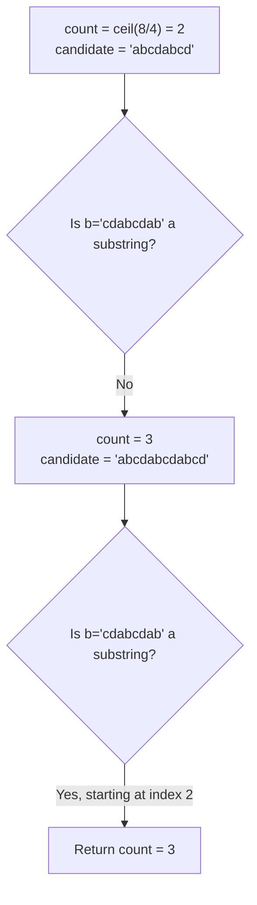

# 686. Repeated String Match

  
**LeetCode:** https://leetcode.com/problems/repeated-string-match/

## Problem
Given two strings `a` and `b`, find the minimum number of times you must repeat `a` (concatenating it with itself) so that `b` becomes a substring of the repeated result. If no amount of repetition makes `b` a substring, return `-1`.

**Input:** `a: str`, `b: str`.
**Output:** `int` — minimum repetitions, or `-1`.

**Example 1:**
`a = "abcd", b = "cdabcdab"` → `3`
`a` repeated 3 times is `"abcdabcdabcd"`, and `"cdabcdab"` is a substring of it (starting at index 2). Repeating only twice (`"abcdabcd"`, length 8) is too short to even contain `b`.

**Example 2:**
`a = "a", b = "aa"` → `2`
`"a"` repeated twice is `"aa"`, which equals `b`.

**Example 3:**
`a = "abc", b = "wxyz"` → `-1`
`b` contains characters (`w, x, y, z`) that never appear in `a` at all, so no repetition of `a` can ever contain `b`.

**Constraints:** `1 <= a.length, b.length <= 10^4`.

> 🔑 **Pattern Recognition**
> "How many repeats of `a` until `b` fits inside" → compute the minimum length arithmetically (`ceil(len(b)/len(a))`, plus one for boundary straddling), then run a single substring search — don't grow the string one copy at a time and re-search from scratch.

## Intuition (explained simply)
For `b` to appear inside repeated copies of `a`, we first need "enough" copies of `a` so the total length is at least `len(b)` — but we also need one extra copy as a safety margin, because `b` might start partway through one copy of `a` and end partway through another. Once we have a candidate repeated string long enough, we just need to check whether `b` is a substring of it.

### 1. Brute Force
- Keep concatenating `a` to itself, one copy at a time, checking after each concatenation whether `b` is now a substring (using Python's `in` operator, which itself does a substring search). Stop as soon as it's found, or give up once the accumulated length exceeds `len(a) + len(b)` (a generous bound — if it's not found by then, it never will be).
- Correct because it tries every reasonable repetition count, from smallest to largest, checking honestly each time.
- Time complexity: O((len(a)+len(b)) · len(b)) roughly — each substring check itself costs up to O(current length · len(b)) with a naive `in` implementation, and we do this repeatedly as the string grows.
- Space complexity: O(len(a) + len(b)) (the growing repeated string)
- Why it's not ideal: repeatedly re-searching a growing string from scratch (and re-checking) wastes work; the number of repetitions needed can be computed directly instead of discovered by trial and error.

### 2. Better
- Compute the minimum repetition count directly via math: `count = ceil(len(b) / len(a))`. Build `a` repeated `count` times, and check if `b` is a substring; if not, try `count + 1` (one more copy, to cover the case where `b` straddles a repetition boundary near the end). Use Python's built-in substring search (`in`, which uses an efficient algorithm internally) rather than a naive character-by-character check.
- This skips the wasted incremental growth-and-recheck of brute force by jumping straight to the two repetition counts that could plausibly work, but it still relies on the built-in substring search being a black box rather than demonstrating the underlying algorithm.
- Time complexity: O((len(a)+len(b))) to build the strings, plus O((len(a)+len(b))) for each `in` check using Python's efficient built-in search — overall roughly O(len(a) + len(b))  Space complexity: O(len(a) + len(b))
- Functionally close to optimal; the true "optimal" tier below makes the underlying search algorithm explicit (KMP) instead of relying on the language's built-in string search.

### 3. Optimal
- Same two-candidate-count math (`ceil(len(b)/len(a))`, then `+1` if needed) to build the minimal-length candidate string, but implement the substring check using **KMP** explicitly (reusing the "find first occurrence" logic from LC 28) instead of a built-in helper — this guarantees the underlying search itself is worst-case linear rather than depending on an unspecified library implementation, which matters for interview settings where you may need to implement the search from scratch.
- Why it works: mathematically, if `b` can appear anywhere in infinitely repeated `a`, it must appear within `ceil(len(b)/len(a)) + 1` copies (any valid starting position within one extra copy's worth of overlap is covered); KMP then finds that occurrence (or confirms its absence) in linear time.
- Time complexity: O(len(a) + len(b)) (building the candidate string + one linear-time KMP search)  Space complexity: O(len(a) + len(b))
- Edge cases: `b` shorter than `a` (still need the `+1` check for wraparound); `b` requiring exactly `ceil` copies vs one more; characters in `b` that never appear in `a` at all (fails immediately, worth an early check for efficiency); `a == b`.

#### 🎯 Visual Walkthrough
Tracing the candidate-count-then-search approach on Example 1's `a = "abcd"`, `b = "cdabcdab"` (expected answer `3`):

Two copies of `a` (length 8, same length as `b`) aren't a match, but three copies give `b` room to straddle the repetition boundary and align at index 2 — matching Example 1's expected output.

## Complexity Summary
| Approach | Time | Space |
|---|---|---|
| Brute Force | O((len(a)+len(b))·len(b)) | O(len(a)+len(b)) |
| Better | O(len(a)+len(b)) | O(len(a)+len(b)) |
| Optimal | O(len(a)+len(b)) | O(len(a)+len(b)) |
