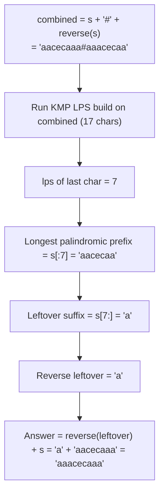

# 214. Shortest Palindrome

  
**LeetCode:** https://leetcode.com/problems/shortest-palindrome/

## Problem
You can add characters only in **front of** a given string to turn it into a palindrome. Return the shortest possible palindrome you can form this way.

**Input:** `s: str`.
**Output:** `str` — the shortest palindrome obtainable by prepending characters to `s`.

**Example 1:**
`s = "aacecaaa"` → `"aaacecaaa"`
The longest palindromic **prefix** of `s` is `"aacecaa"` (7 chars); the leftover suffix `"a"` needs to be reversed and prepended: `"a" + "aacecaaa" = "aaacecaaa"`.

**Example 2:**
`s = "abcd"` → `"dcbabcd"`
No palindromic prefix longer than `"a"` exists, so almost the whole reversed string (`"dcb"`) must be prepended: `"dcb" + "abcd" = "dcbabcd"`.

**Example 3:**
`s = "aba"` → `"aba"`
`s` is already a palindrome — nothing needs to be added.

**Constraints:** `0 <= s.length <= 5 * 10^4`, lowercase English letters.

> 🔑 **Pattern Recognition**
> "Only allowed to prepend, want shortest palindrome" → the answer hinges entirely on the longest palindromic *prefix*; finding it reduces to a KMP failure-function trick on `s + separator + reverse(s)`. Whenever a problem needs "longest prefix of X matching a property tied to X's reverse," concatenating with a separator and running KMP is the move.

## Intuition (explained simply)
If `s` already starts with a palindrome of length `k` (a "palindromic prefix"), then everything *after* that prefix (the remaining suffix) is what's "unbalanced" and needs a mirror image added in front. The bigger that palindromic prefix is, the less we need to add — so the goal is: find the **longest palindromic prefix** of `s`, then prepend the reverse of everything after it.

### 1. Brute Force
- For every possible prefix length from `len(s)` down to `1`, check whether that prefix is a palindrome (comparing it to its own reverse). The first (longest) one that is a palindrome is the one we use — prepend the reverse of the remaining suffix.
- Correct because it directly checks every candidate prefix length, from longest to shortest, for the palindrome property.
- Time complexity: O(n²) (up to n candidate lengths, each palindrome check costs O(n))  Space complexity: O(n)
- Why it's not good enough: O(n²) is too slow for `n` up to 5×10⁴ (~2.5×10⁹ operations).

### 2. Better
- Use **Manacher's algorithm** (or simpler: precomputed palindrome-radius info) to find, in O(n), the longest palindromic substring that starts exactly at index 0. Manacher's algorithm computes, for every center in the string, the radius of the longest palindrome centered there, in O(n) total; from that data we can pick out palindromes anchored at index 0.
- This finds the longest-palindromic-prefix answer in linear time, but Manacher's algorithm is notoriously fiddly to implement correctly (transforming the string with separator characters, tracking the rightmost boundary and mirror index) — powerful, but heavyweight machinery for what turns out to have a simpler dedicated trick.
- Time complexity: O(n)  Space complexity: O(n) (the transformed string + radius array)
- Correct and linear, but more complex than necessary — a more direct, more interview-friendly O(n) technique exists for this specific "prefix" formulation (rather than "any substring"), shown next.

### 3. Optimal
- Build a combined string: `s + '#' + reverse(s)` (the `#` separator, a character guaranteed not to appear in `s`, prevents the KMP match from "crossing over" between the two halves). Run KMP's failure-function (LPS array) construction on this combined string. The **last value** of that LPS array tells you the length of the longest prefix of `s` that is also a suffix of `reverse(s)` — which is *exactly* the longest palindromic prefix of `s` (a string matching its own reverse's suffix, anchored at the start, is precisely a palindrome). Everything in `s` after that length needs to be reversed and prepended.
- Why it works: `reverse(s)`'s suffix of length `k` equals `s`'s prefix of length `k` if and only if that prefix, read forwards, equals itself read backwards from the *other* string — which collapses to "that prefix of `s` is a palindrome" exactly when we're comparing `s` against its own reverse this way. The separator guarantees the LPS value can never exceed `len(s)` (no false matches spanning across into the reversed half).
- Time complexity: O(n) (build combined string of length `2n+1`, run one linear KMP-LPS pass)  Space complexity: O(n)
- Edge cases: empty string → return `""`; already a palindrome (LPS hits `n`, nothing to prepend); single character (trivially a palindrome); all identical characters.

#### 🎯 Visual Walkthrough
Tracing the optimal approach on Example 1's `s = "aacecaaa"` (expected answer `"aaacecaaa"`):

The `#` separator caps the LPS value at `len(s)`, so it can never falsely detect a match spanning across into the reversed half.

## Complexity Summary
| Approach | Time | Space |
|---|---|---|
| Brute Force | O(n²) | O(n) |
| Better (Manacher's) | O(n) | O(n) |
| Optimal (KMP on s+#+rev(s)) | O(n) | O(n) |
