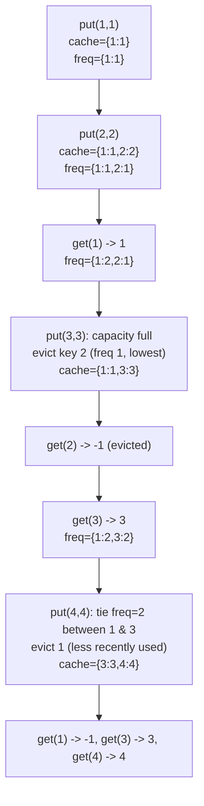

# 460. LFU Cache

  
**LeetCode:** https://leetcode.com/problems/lfu-cache/

## Problem
Design a fixed-capacity cache that evicts the **Least Frequently Used** entry when it's full and a new key needs to be inserted. If there's a tie in frequency among candidates to evict, evict the **least recently used** one among them. Support:
- `get(key)`: return the value if present (and count this as a "use," incrementing its frequency), else `-1`.
- `put(key, value)`: insert or update a key's value (also counts as a use); if inserting a new key would exceed capacity, evict per the LFU+LRU tie-break rule first.

**Example:**
```
LFUCache(2)
put(1, 1)   # cache: {1:1}, freq{1:1}
put(2, 2)   # cache: {1:1, 2:2}, freq{1:1, 2:1}
get(1) -> 1 # freq{1:2, 2:1}
put(3, 3)   # capacity full, evict key 2 (freq 1, least frequent) -> cache: {1:1, 3:3}
get(2) -> -1 # was evicted
get(3) -> 3  # freq{1:2, 3:2}
put(4, 4)   # evict between keys 1 and 3 (tied freq 2) -> evict 1 (used less recently) -> cache: {3:3, 4:4}
get(1) -> -1
get(3) -> 3
get(4) -> 4
```

**Constraints:** `0 <= capacity <= 10^4`, up to `2*10^5` total calls, keys/values fit in a 32-bit int.

> 🔑 **Pattern Recognition**
> Need O(1) eviction by "least frequent, tie-broken by least recent" → group keys into frequency buckets, and make each bucket itself an ordered structure (an `OrderedDict`) so both "find the LRU member of the min-frequency bucket" and "move a key between buckets" are O(1). Two eviction criteria stacked together is the cue for two-level bucketing rather than one hash map with a linear scan.

## Intuition (explained simply)
We need to track two things about every key at once: **how often** it's used (frequency) and, among equally-frequent keys, **how recently** it was used (for the tie-break). The efficient trick is to group keys into "buckets" by frequency, where within each bucket the keys are kept in least-recently-used-to-most-recently-used order — that way, evicting is always "look at the lowest-frequency bucket, remove its oldest entry."

### 1. Brute Force
- Store everything in one hash map: `key -> (value, frequency, last_used_time)`, with a global counter incremented on every access to stamp "time." On `get`/`put` for an existing key, bump its frequency and update its timestamp — both O(1). When eviction is needed, **scan every entry** in the map to find the one with the lowest frequency (breaking ties by the smallest timestamp), and remove it.
- Correct — it directly tracks the two pieces of information the problem needs and picks the eviction candidate by definition.
- Time complexity: `get`/`put` O(1) when no eviction is needed, but O(n) whenever eviction must scan the whole cache to find the victim.  Space complexity: O(n)
- Why it's not good enough: with up to 2×10⁵ calls and capacity up to 10⁴, frequent O(n) eviction scans add up badly — the problem explicitly wants O(1) for every operation.

### 2. Better
- Maintain: a hash map `key -> (value, frequency)`, and a second hash map `frequency -> list of keys` (keys appended in order of use, so the front of a bucket's list is its least-recently-used member). Track `min_freq` separately. On access, remove the key from its old frequency bucket's list (using `list.remove(key)`, a **linear scan** within that bucket) and append it to the new (incremented) frequency's list. Eviction pops from the front of the `min_freq` bucket's list.
- This groups keys by frequency (a real structural improvement — no more scanning the *whole* cache for the minimum), but removing a key from the middle of a plain Python list is still O(bucket size) due to the shift, so operations aren't truly O(1).
- Time complexity: O(b) per operation, where b = size of the frequency bucket being modified (worst case O(n) if one frequency dominates)  Space complexity: O(n)
- The list-based buckets are the remaining bottleneck — swapping them for a structure with O(1) arbitrary removal fixes this.

### 3. Optimal
- Same frequency-bucket idea, but each bucket is an **ordered hash set** (in Python, an `OrderedDict` used as a key-only container, or conceptually a doubly linked list + hash map of nodes) instead of a plain list. This gives O(1) removal of *any* key from a bucket (no shifting) while still preserving insertion order (so we always know the least-recently-used member of a bucket is at the front). Maintain `min_freq` incrementally: it only ever needs to increase when the current minimum-frequency bucket becomes empty (which only happens right after we bump something out of it), or reset to 1 whenever a brand new key is inserted.
- Why it works: an `OrderedDict` gives O(1) `popitem(last=False)` (remove-from-front, the LRU victim) and O(1) arbitrary-key deletion (when a key's frequency changes, we delete it from its old bucket by key directly, no scan needed) — combining the frequency-grouping idea with a data structure that supports O(1) mutation at both ends.
- Time complexity: `get` O(1), `put` O(1), all average-case (amortized for the hash map operations).  Space complexity: O(n) (capacity-bounded, plus the frequency-bucket bookkeeping)
- Edge cases: `capacity == 0` (never store anything, every `put` is a no-op, every `get` returns -1); `get`/`put` on a key that bumps it into a brand-new highest frequency bucket; eviction tie-break must pick the least-recently-used among equally-frequent keys, not an arbitrary one.

#### 🎯 Visual Walkthrough
Tracing the frequency-bucket design on the problem's own worked example (`capacity = 2`):



When `1` and `3` tie at frequency `2`, the frequency-2 bucket's `OrderedDict` remembers `1` was touched before `3` — so `1` sits at the front and is evicted first, in O(1).

## Complexity Summary
| Approach | get | put | Space |
|---|---|---|---|
| Brute Force | O(1) / O(n) on evict | O(1) / O(n) on evict | O(n) |
| Better | O(bucket size) | O(bucket size) | O(n) |
| Optimal | O(1) | O(1) | O(n) |
