# 307. Range Sum Query - Mutable

 -blue) 
**LeetCode:** https://leetcode.com/problems/range-sum-query-mutable/

## Problem
Given an integer array, support two operations, interleaved in any order and repeated many times:
- `update(index, val)`: change the value at `index` to `val`.
- `sumRange(left, right)`: return the sum of elements from index `left` to `right`, inclusive.

**Example:**
```
nums = [1, 3, 5]
sumRange(0, 2) -> 9        # 1+3+5
update(1, 2)               # nums becomes [1, 2, 5]
sumRange(0, 2) -> 8        # 1+2+5
```

**Constraints:** `1 <= nums.length <= 3*10^4`, up to `3*10^4` calls to `update` and `sumRange` combined.

> 🔑 **Pattern Recognition**
> "Point update + range sum query, both interleaved and frequent" → neither a plain array nor a prefix-sum array is fast at both; a Fenwick Tree (BIT) gets O(log n) for both by storing partial sums keyed to each index's lowest set bit.

## Intuition (explained simply)
This is a "point update, range query" problem — a single value changes, and we ask for sums over ranges, over and over. The naive approach re-adds a whole range from scratch every query, which is slow if there are thousands of both updates and queries. We need a structure where **both** updating one value **and** querying a range sum are fast — not just one or the other. This is exactly the problem a **Fenwick Tree** (Binary Indexed Tree, or "BIT") was invented to solve. If you've never implemented one before, here's the idea from scratch:

**What problem does a Fenwick Tree solve?** It solves "point update + prefix sum query" in O(log n) each, using only O(n) extra space, and it does so with a clever trick: instead of storing "the sum of everything up to index i" directly (which would need O(n) to update, since changing one value would ripple through every later prefix sum), it stores partial sums in a specific pattern based on the **binary representation of indices** so that both operations only ever touch O(log n) array slots.

**How it works, intuitively:** Picture the array indices (1-based) in binary. Every index `i` "owns" a range of the original array whose length is determined by the lowest set bit of `i` (e.g. index `12 = 0b1100` owns a range of length `4` — the lowest set bit — ending at index 12). `tree[i]` stores the sum of that specific range. To get the prefix sum up to index `i`, you repeatedly jump backward by subtracting the lowest set bit (`i -= i & (-i)`), summing `tree[i]` along the way — this visits O(log n) nodes because each jump strips off one binary digit. To update index `i`, you do the reverse: repeatedly jump *forward* by adding the lowest set bit (`i += i & (-i)`), updating every `tree[i]` whose "owned range" includes the changed index — also O(log n) nodes, because there are only O(log n) ancestors in this implicit tree structure. A range sum `sumRange(l, r)` is then just `prefixSum(r) - prefixSum(l-1)`.

### 1. Brute Force
- Store the array directly. `update(index, val)`: overwrite `nums[index] = val`, O(1). `sumRange(left, right)`: loop from `left` to `right`, summing as you go, O(right - left).
- Correct — it's the literal definition of both operations.
- Time complexity: `update` O(1), `sumRange` O(n)  Space complexity: O(n)
- Why it's not good enough: if `sumRange` is called many times over large ranges, this is far too slow (up to 3×10⁴ queries over ranges up to 3×10⁴ long — potentially ~10⁹ operations).

### 2. Better
- Build a **prefix sum array** once: `prefix[i] = nums[0] + ... + nums[i-1]`. Then `sumRange(left, right) = prefix[right+1] - prefix[left]` in O(1). But now `update(index, val)` requires rebuilding every prefix sum from `index` onward (since they all depend on `nums[index]`), which costs O(n) per update.
- This flips the bottleneck: queries become instant, but updates become slow — a straight trade-off rather than a genuine improvement when both operations are frequent.
- Time complexity: `update` O(n), `sumRange` O(1)  Space complexity: O(n)
- Only good if updates are rare; the problem interleaves both operations freely, so we need a structure that's fast at *both* simultaneously.

### 3. Optimal
- **Fenwick Tree (Binary Indexed Tree)**, as described above. Build it once from the initial array in O(n log n) (n calls to a O(log n) point-update), or O(n) with a specialized build. `update(index, val)`: compute the *delta* (`val - nums[index]`), update `nums[index] = val`, then propagate that delta through the tree in O(log n). `sumRange(left, right)`: compute `prefixSum(right) - prefixSum(left - 1)` in O(log n) total (each prefix sum is O(log n)).
- Why it works: as explained above, the binary-indexed structure guarantees any point update or prefix query only ever touches O(log n) tree nodes, because the "lowest set bit" jump pattern visits exactly the ancestors/owned-ranges relevant to that index.
- Time complexity: `update` O(log n), `sumRange` O(log n)  Space complexity: O(n) (the tree array, same size as the input plus one for 1-indexing)
- Edge cases: `sumRange(i, i)` (single element); updating an index to the same value it already had (still correct, just a zero delta); array of length 1; `left == 0` in `sumRange` (must not compute `prefixSum(-1)` — guard with `prefixSum(left-1)` returning 0 when `left == 0`).

#### 🎯 Visual Walkthrough
The Fenwick tree built from the example's `nums = [1, 3, 5]` (1-indexed positions 1..3), where each node owns a range determined by its lowest set bit:

```mermaid
graph TD
    N1["tree&#91;1&#93; = 1<br/>owns nums&#91;0..0&#93;"] -->|update propagates up to| N2["tree&#91;2&#93; = 4<br/>owns nums&#91;0..1&#93;"]
    N3["tree&#91;3&#93; = 5<br/>owns nums&#91;2..2&#93;"]
```



**`sumRange(0, 2)` = `prefixSum(3)`** (jump backward by lowest set bit: `3 -> 2 -> 0`):

| i | tree[i] | next i = i - (i & -i) |
|---|---|---|
| 3 | 5 | 2 |
| 2 | 4 | 0 (stop) |

Sum = `5 + 4 = 9` — matches the example.

**`update(1, 2)`** (0-indexed index 1, old value `3`, delta `= 2 - 3 = -1`, propagate forward by lowest set bit from 1-indexed position `2`):

| i | tree[i] before | tree[i] after | next i = i + (i & -i) |
|---|---|---|---|
| 2 | 4 | **3** | 4 (> n, stop) |

Now `sumRange(0, 2) = tree[3] + tree[2] = 5 + 3 = 8` — matches the example's second query.

## Complexity Summary
| Approach | update | sumRange | Space |
|---|---|---|---|
| Brute Force | O(1) | O(n) | O(n) |
| Better (prefix array) | O(n) | O(1) | O(n) |
| Optimal (Fenwick Tree) | O(log n) | O(log n) | O(n) |
