# 480. Sliding Window Median

  
**LeetCode:** https://leetcode.com/problems/sliding-window-median/

## Problem
Given an array `nums` and a window size `k`, slide a window of size `k` across the array one step at a time, and for each window position, report the **median** of the `k` numbers currently in the window. (The median of an even-sized window is the average of its two middle values.)

**Input:** `nums: List[int]`, `k: int`.
**Output:** `List[float]` — the median at each window position (there are `len(nums) - k + 1` of them).

**Example 1:**
`nums = [1,3,-1,-3,5,3,6,7], k = 3` → `[1.0, -1.0, -1.0, 3.0, 5.0, 6.0]`
Window `[1,3,-1]` sorted is `[-1,1,3]`, median `1`. Window `[3,-1,-3]` sorted is `[-3,-1,3]`, median `-1`. And so on, sliding one step at a time.

**Example 2:**
`nums = [1,2,3,4,2,3,1,4,2], k = 3` → `[2.0, 3.0, 3.0, 3.0, 2.0, 3.0, 2.0]`

**Example 3:**
`nums = [1,2], k = 2` → `[1.5]`
Only one window `[1,2]`; even-sized, so median is the average `(1+2)/2 = 1.5`.

**Constraints:** `1 <= k <= nums.length <= 10^5`, values fit in a 32-bit int.

> 🔑 **Pattern Recognition**
> "Running median" → two balanced heaps (max-heap for the smaller half, min-heap for the larger half). "...but elements also leave the window" → heaps can't remove from the middle efficiently, so pair the two-heaps trick with **lazy deletion** (mark-as-removed, clean up only when a stale value would surface at the top).

## Intuition (explained simply)
This combines two classic ideas: **"find median of a running stream" (two-heaps trick)** and **"sliding window."** The two-heaps trick for a running median works by splitting numbers into a max-heap of the smaller half and a min-heap of the larger half, keeping them balanced in size — the median is then always at the top of one (or both) heaps. The extra twist here is that elements also need to **leave** the window as it slides, and heaps don't support efficient arbitrary removal — so the optimal solution uses a trick called **lazy deletion** to work around that.

### 1. Brute Force
- For each window position, extract the `k` elements (`nums[i:i+k]`), sort them, and read off the median (middle element, or average of the two middle elements if `k` is even).
- Correct — directly computes the definition of median for each window from scratch.
- Time complexity: O(n · k log k) (n-k+1 windows, each sorted in O(k log k))  Space complexity: O(k) per window
- Why it's not good enough: re-sorting the entire window from scratch every single slide is wasteful — most of the window's contents don't change between consecutive positions (only one element leaves, one enters).

### 2. Better
- Maintain the current window as a **sorted list** (e.g. a Python list kept sorted). When sliding: remove the outgoing element using `bisect` to find its position (O(log k) to find, but O(k) to physically shift the list) and insert the incoming element the same way (`bisect.insort`, O(log k) to find + O(k) to shift). Read the median directly from the middle of the sorted list in O(1).
- This avoids re-sorting from scratch every time (a real improvement — we maintain sortedness incrementally instead of rebuilding it), but insertion/removal from the middle of a Python list still costs O(k) due to shifting elements.
- Time complexity: O(n · k) (n windows, O(k) per slide for the shift)  Space complexity: O(k)
- Still not great for large `k` — the shifting cost dominates. A structure with O(log k) removal (not just O(log k) *search*) is what's needed, which heaps + lazy deletion provide.

### 3. Optimal
- **Two heaps with lazy deletion.** Maintain a max-heap (`lo`, storing the smaller half, negated for Python's min-heap) and a min-heap (`hi`, storing the larger half), balanced so `len(lo)` is either equal to `len(hi)` or exactly one more. The median is `lo`'s top (odd `k`) or the average of both heaps' tops (even `k`). The challenge: when an element leaves the window, we can't efficiently remove it from the middle of a heap. Instead, use **lazy deletion**: keep a hash map counting how many times each value is "pending removal." When an element should leave, just increment its pending-removal count — don't touch the heap yet. Whenever a heap's *top* element turns out to have a pending removal, pop it off for real and decrement the counter (this "cleanup" happens lazily, only when that stale value would otherwise be read as the answer). Track the heaps' *effective* sizes (accounting for pending removals) separately to know when to rebalance.
- Why it works: a heap only needs its top element to be valid at read-time — elements buried in the middle can be "logically deleted" and cleaned up later, lazily, the moment they'd otherwise surface at the top. This turns what would be an O(k) removal into an amortized O(log k) operation (each element is pushed once and popped at most once over the whole algorithm).
- Time complexity: O(n log k) (n slides, O(log k) heap operations each, amortized for the lazy cleanup)  Space complexity: O(k) (both heaps plus the pending-removal map)
- Edge cases: `k == 1` (median is just the element itself); `k == len(nums)` (only one window); duplicate values (the pending-removal map must count *occurrences*, not just presence, since duplicates can be simultaneously in the window and pending removal); rebalancing after both an insertion and an outgoing removal in the same slide.

#### 🎯 Visual Walkthrough
Tracing the balanced two-heap state through the first few windows of Example 1's `nums = [1, 3, -1, -3, 5, 3, 6, 7], k = 3` (expected medians `[1.0, -1.0, -1.0, 3.0, ...]`). `lo` = max-heap of the smaller half (size 2), `hi` = min-heap of the larger half (size 1); median = `lo`'s top:

```mermaid
flowchart TD
    A["Window &#91;1,3,-1&#93;<br/>lo={1,-1} top=1<br/>hi={3}<br/>median=1.0"] --> B["Slide: 1 leaves, -3 enters<br/>Window &#91;3,-1,-3&#93;<br/>lo={-1,-3} top=-1<br/>hi={3}<br/>median=-1.0"]
    B --> C["Slide: 3 leaves, 5 enters<br/>Window &#91;-1,-3,5&#93;<br/>lo={-3,-1} top=-1<br/>hi={5}<br/>median=-1.0"]
    C --> D["Slide: -1 leaves, 3 enters<br/>Window &#91;-3,5,3&#93;<br/>lo={-3,3} top=3<br/>hi={5}<br/>median=3.0"]
```

`lo`'s top is always the max of the smaller half, which is exactly the median when `k` is odd — matching Example 1's first four outputs `1.0, -1.0, -1.0, 3.0`.

## Complexity Summary
| Approach | Time | Space |
|---|---|---|
| Brute Force | O(n·k log k) | O(k) |
| Better | O(n·k) | O(k) |
| Optimal | O(n log k) | O(k) |
